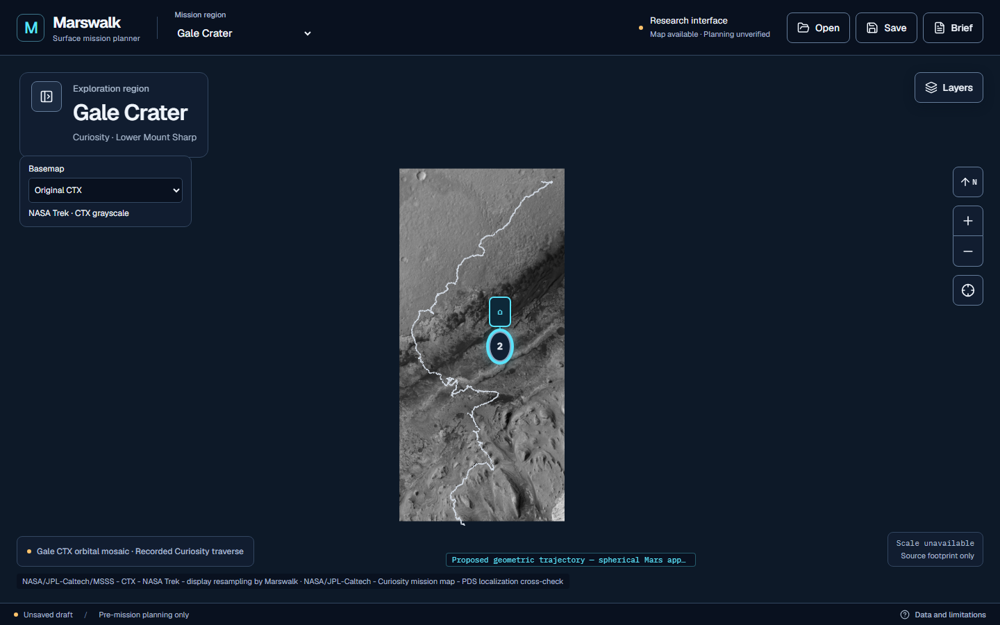
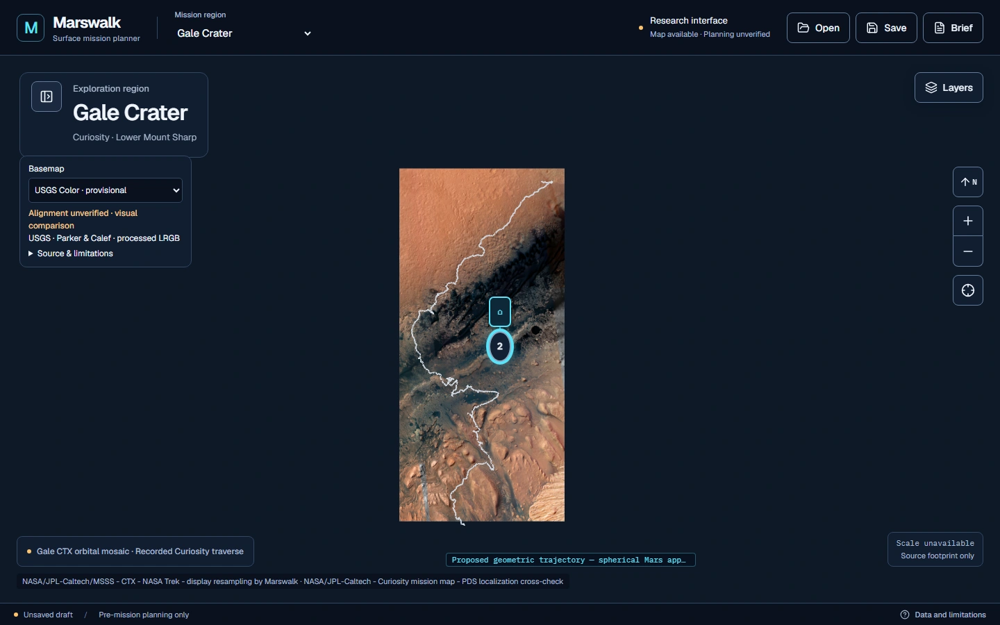
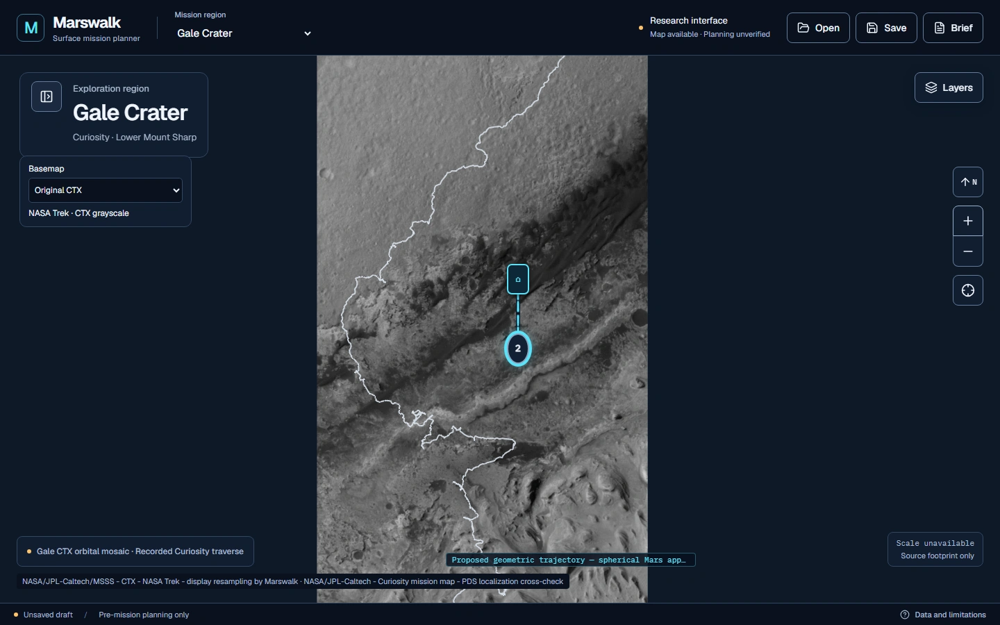
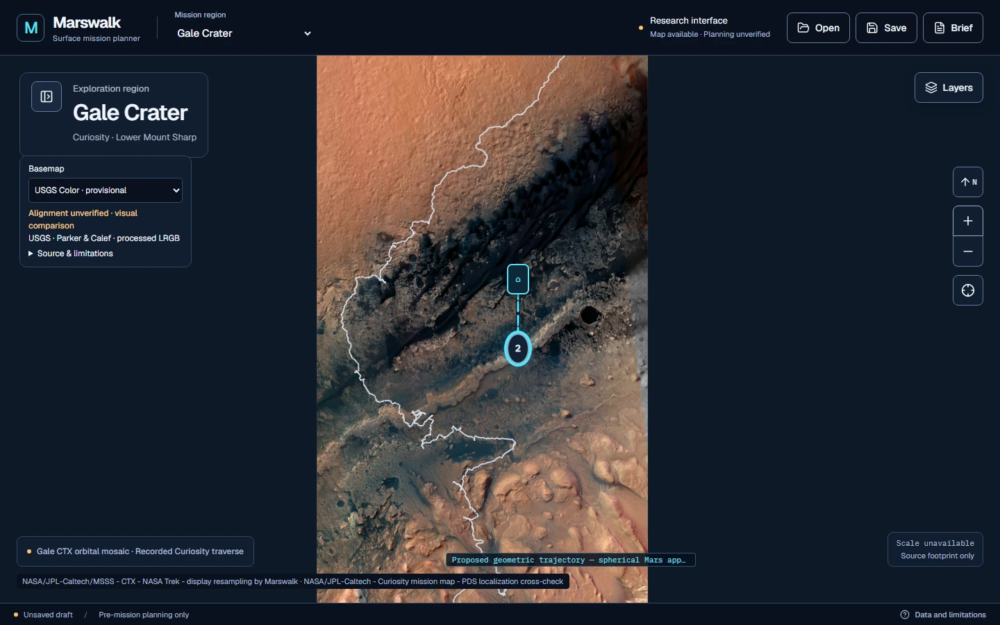
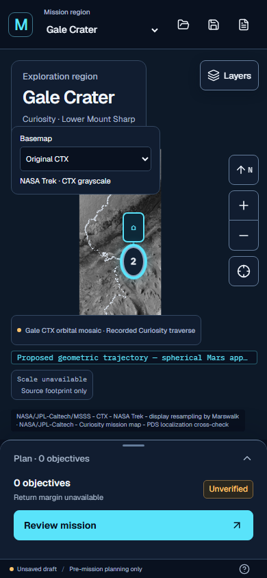
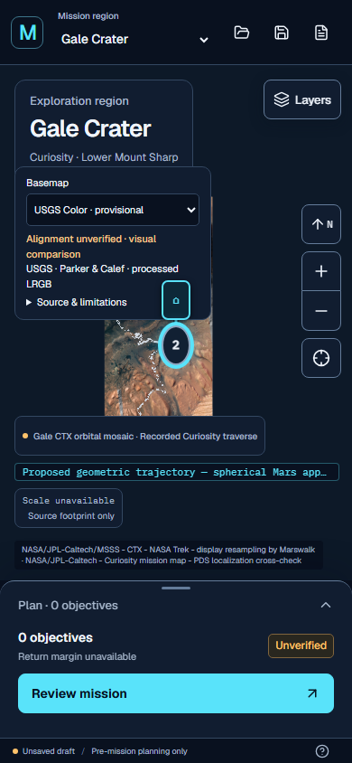

# Gale G5 Phase 2 — provisional USGS processed-color integration

Reviewed 14 November 2026 (Asia/Rangoon). Actual source imagery is integrated;
**independent local registration remains incomplete**. The optional mode is
classified **Georeferenced but alignment unverified**, never “validated for
display.” CTX remains the startup/default basemap. This delivers the defensible
provisional comparison permitted by the Phase 2 brief, not a precise terrain
registration or an operational safety product.

## Isolation and unchanged science

Fetched `origin` before implementation. The latest verified `origin/feat/gale-map`
was `a5809dad9ed0f52c0604f3a00c327b666d8d95e2`; ancestry checks passed for
`9675a55cd61135f1e9a480325f2294ae895a95fd` and M3 hardening
`08ccedb7c635ab89603d6444b30e6fe4f7e7d6d4`.

Branch: `feat/gale-color-basemap`. Dedicated worktree:
`D:\martian-map\output\gale-g1\output\gale-color-basemap`.
No existing worktree was switched, reset, cleaned or edited. No G4 preprocessing
or metadata was changed. No merges into development/main/Antigravity branches.
The exact delivery SHA is the commit containing this report; resolve with
`git log -1 --format=%H -- docs/GALE_COLOR_BASEMAP_INTEGRATION_REPORT.md`.
The delivery response records the verified push SHA.

Region configurations, scientific manifests, original CTX assets, DEM, slope,
hillshade, geology, rover traverse, mission engine, planner, region-layer
infrastructure and Jezero/Oxia are unchanged from the verified baseline.
MapWorkspace adds only the optional controller, loaded-map reference and an
exception allowing color-source failures to use CTX instead of disabling map
navigation. Camera formulas, fit/reset behavior, zoom bounds, geodesy and M3
placement/trajectory logic have no edits.

Unchanged overview: **137.3442352329006–137.4579431096443° E,
−4.822361175063087–−4.580605407446296° N**. Planetocentric latitude, east-positive
0–360 longitude, Mars sphere **R = 3,396,190 m**. No image offset or warp.

## Source evidence reused

- [USGS official catalogue](https://astrogeology.usgs.gov/search/map/mars_msl_gale_merged_orthophoto_mosaic_25cm).
  The Phase 1 pinned HTML is retained; a fresh browser fetch returned HTTP 403.
- [USGS processed LRGB COG](https://asc-pds-services.s3.us-west-2.amazonaws.com/mosaic/Mars/MSL/MSL_Gale_HiRISE-LRGB_78quads_sharp_cog.tif).
  Credit **Timothy Parker and Fred J. Calef III**, USGS Astrogeology / NASA /
  JPL-Caltech / UArizona, with HRSC/ESA lineage where applicable.
- [USGS grayscale orthophoto v3](https://asc-pds-services.s3.us-west-2.amazonaws.com/mosaic/MSL_Gale_Orthophoto_Mosaic_25cm_v3.tif).
  Calef III & Parker (2016), *MSL Gale Merged Orthophoto Mosaic*, PDS Annex, USGS.
- [NASA Trek CTX WMTS](https://trek.nasa.gov/tiles/Mars/EQ/Gale_CTX_BlockAdj_dd/1.0.0/WMTSCapabilities.xml).
- [Phase 1 audit](../team/gale/sources/g5/audit.json),
  [Phase 1 report](GALE_BASEMAP_UPGRADE_REPORT.md),
  [prior registration investigation](../team/gale/REGISTRATION_INVESTIGATION.md).

The catalogue requests author credit and lists no use constraint. No agency
endorsement or branding permission is implied. The source has author-applied
manual color balancing/blending, LRGB fusion, GIMP unsharp masking and JPEG
quality-85 COG conversion. Its processed color is not guaranteed human-eye true
color. No local color fabrication, sharpening, super-resolution or AI imagery.

Reused findings: 36,000 × 76,000 RGB uint8, 0.25 m grid, actual Mars GeoKeys,
source-specific affine, internal validity mask, existing overviews, and **100%
native-mask validity across the configured overview** within floating precision.
That mask does not establish native RGB-strip contribution, homogeneous HiRISE
detail, seam-free imagery or precise overlay alignment.

Source identity remains 1,030,625,379 bytes, ETag
`adae62ea1be4cf769f7232a2a7dee80c-60`, S3 version
`0ZDib2C._2LbtlqGD1_o4uHnz0whyvNj`. ETag is not asserted to be a full-file MD5.
Range SHA-256 receipts identify only accessed bytes, not the entire remote file.

## Registration investigation and limits

[Machine-readable evidence](../team/gale/sources/g5-phase2/registration.json)
and [same-coordinate distributed panels](../team/gale/sources/g5-phase2/distributed-comparisons.webp)
record six spatially distributed CTX/color comparisons. Four were exploratory;
two southern windows were reserved as held-out diagnostics. Nothing was fitted
to either group. RGB mean brightness and CTX DN are compared on identical z13
display pixels (~10.17 m angular spacing), with common valid-mask support.
Both retain their own source/display transformations. Native source support,
photometry, illumination and mosaic control lineage differ; resampling to a
common display grid cannot make their point-spread functions identical.

Zero-shift brightness correlations, north to south: **0.0792, 0.4947, 0.3526,
−0.1705, 0.0405, 0.2580**. These are image diagnostics, not measured positional
residuals or a translation solution. Visual review shows unresolved differences
in the northern crater field and southern ridge/channel margins. No unique
geometric cause, global offset or correction is supported by these panels.

The pinned grayscale patch `(72000,154000,128,128)` covers only **32 × 32 m**.
Its original GeoTIFF SHA-256 remains
`707d4815759271820868ca9098a929ac9e082733bfcfa76a078d8ba33c429ffc`.
Native grayscale is averaged over 8 × 8 cells onto 2 m support and compared
against coordinate-inverted color support; zero-shift brightness correlation
is **0.9462**. This demonstrates local image similarity at that patch; it neither
validates the whole overview nor supplies independent absolute control.
[Research-patch comparison](../team/gale/sources/g5-phase2/gray-color-research-patch.png).

Published lineage: grayscale HRSC controlled to MOLA, CTX tied to HRSC, HiRISE
tied to CTX/previous HiRISE; color strips manually tied, blended and fused to
the mission RED orthophoto. The published approximate 100 m base-control context
is **not** a validated local error bound. The exact Trek mosaic control chain
remains unestablished.

**Accepted independent photographed-feature controls: zero.** Positional RMSE
and uncertainty are explicitly null, not zero. Window centers and rover-position
rows are not substituted for photographed-feature controls. Held-out windows
are reserved comparisons, not independent survey checkpoints. Future normal
display validation requires distributed recognizable-feature correspondences,
independent checking, held-out residuals and defensible uncertainty. No source
is moved to improve appearance. Operational terrain sampling, hazard
classification and astronaut safety certification remain disabled.

## Reproducible tile preparation

[Generator](../scripts/gale-basemap/color_tiles.py),
[instructions](../scripts/gale-basemap/README.md), and
[output manifest](../public/maps/gale/usgs-color/manifest.json).
All assets needed at runtime are committed and locally served. Another team
member can run the normal application without Python, source downloads or
ignored machine-local paths. Python is needed only to regenerate the assets.

The generator validates actual TIFF metadata against Phase 1 and reconstructs
only the COG prefix containing factor-8 and coarser imagery/masks. Rasterio opens
**overview index 2, factor 8**, explicitly: 4,500 × 9,500 RGB, **2 m working
grid**, same source origin. It never requests native full-image strips or reads
the 50.4 GB grayscale raster. Smaller four-range batches and persistent receipts
recover from observed USGS timeouts. The successful cached replay accounts for
**14,639,067 source bytes**, including metadata. The unique prefix is under
16 MiB; the hard read/replay budget is 32 MiB including retries. Initial failed
attempts consumed additional network traffic and are not represented as a
single successful-run total.

For destination edges `u=x*256+i`, `v=y*256+j`, `S=256*2^z`:

```text
lon = 360*u/S - 180
lat = atan(sinh(pi*(1 - 2*v/S)))
E = R*lon_radians; N = R*lat_radians
source pixel-edge column = (E - 8,140,000)/0.25
source pixel-edge row    = (-270,000 - N)/0.25
native pixel center: E=8,140,000+(column+0.5)*0.25
                     N=-270,000-(row+0.5)*0.25
working overview uses 2 m instead of 0.25 m
```

These XYZ equations are angular display encoding, never an Earth geodetic CRS.
Exact separable source-cell area overlaps integrate valid RGB support across
each destination pixel. RGB is normalized by valid support, alpha records that
support, and destination centers outside the existing overview are transparent.
Source NoData is determined by the internal mask, never RGB black. No guessed
half-pixel shift, extrapolation or sparse native-pixel downsampling.

| Property | Delivered |
| --- | --- |
| Zoom range / tile size | z5–15 / 256 × 256 |
| Counts z5–10 | 1 each |
| Counts z11 / z12 / z13 / z14 / z15 | 2 / 6 / 18 / 72 / 253 |
| Total | **357 tiles** |
| Encoded image bytes | **21,482,684** (20.49 MiB) |
| Largest tile | 101,022 bytes |
| Encoding | Lossless RGB/RGBA WebP |
| Finest angular spacing on Mars | ~2.54 m/pixel |
| Original source grid / selected overview | 0.25 m / factor 8, 2 m |
| Coverage | Same configured overview; transparent outside |
| Effective native image/color detail | Spatially variable, unmeasured |

The initially proposed 20 MiB asset cap was exceeded by 0.49 MiB; the explicit
release cap is 24 MiB. This preserves lossless derivatives with small individual
files suitable for ordinary Git hosting, rather than adding further lossy
encoding. Final regeneration took **105.56 seconds** in the successful cached run.
Every tile's SHA-256 and software versions are recorded. No full raster or
temporary GeoTIFF is committed.

This improves served sampling by four times relative to the existing finest
CTX display grid. It does **not** establish four times effective source detail
everywhere. Zooms above 15 overzoom existing tiles, including close geology
views; they do not reveal additional prepared native data.

USGS high-detail grayscale is deferred to Phase 3: overview validity, distributed
registration and practical broad extraction remain unresolved. No misleading
grayscale option is displayed. Original CTX grayscale remains available.

## Map integration, M3 and accessibility

The compact native labelled select offers `Original CTX` and
`USGS Color · provisional`. Color is lazy-loaded only on selection. One color
layer sits immediately above the existing CTX fallback and below terrain,
geology, traverse, trajectories and DOM waypoint/science markers. Scientific
layer visibility and opacity remain controlled by the existing layer panel.
Color follows the optical layer's visibility and opacity. Map camera and
mission state are not inputs to or modified by the controller.

A persistent alignment warning and processed-LRGB author credit remain visible
in color mode. Expandable limitations link to USGS and state source processing,
variable detail and lack of terrain-safety validation. The native select works
with keyboard/touch and has an associated source description; the control uses
the existing dark space-themed design. It hides with the expanded mobile
planning sheet and is available again when the sheet collapses.

MapLibre normally suppresses HTTP 404 errors as sparse tile coverage. A narrow
`marswalk-usgs` request protocol fetches the same local static assets and turns
unsuccessful responses into source-specific errors. Color failures hide the
alternative, restore the selector to CTX and announce the fallback without
disabling navigation, moving the camera or changing waypoints. Other region
and source error behavior is preserved. Switching region/preview removes the
alternative; returning starts with CTX. Basemap selection is presentation state,
so it is not added to the mission-file schema.

## Validation and screenshots

Scientific Python: **27 passed**, including inherited CRS/geodesy/terrain
checks and new source affine, XYZ edge/center, support averaging, NoData,
color-channel/alpha integrity, reproducible encoding, every delivered tile hash,
extent/alpha coverage, unsupported affine and registration-evidence checks.
Node: **160 passed**, including the controller contract proving only color-layer
state changes, single mounting, preserved opacity and ordering below terrain.
TypeScript, ESLint and the Next.js production build passed.

**Final full Playwright run: 56 passed, 0 failed, 4.3 minutes**, against the
isolated production server on port 3115: all 49 inherited regressions plus all
seven G5 tests. This includes all four required viewport sizes. No existing
test was weakened or removed. All scientific Python tests, final typecheck and
ESLint were rerun successfully after final tile/test preparation.

Browser tests cover actual colored pixels and successful real
tile responses, 1440/1024/768/390 viewports, M3 placement in both modes, unchanged
marker projection/coordinates through switches, trajectory persistence,
navigation/reset, source-specific 404 fallback with a waypoint, region switching,
terrain visibility/opacity, mission save/open, overflow and accessibility.
The existing 49 tests remain unchanged.

Reproduction commands (PowerShell, from the isolated checkout):

```powershell
npm.cmd ci
npx.cmd tsx --test tests/*.test.ts
python -B -m unittest discover -s tests -p 'test_gale_*.py' -v
npm.cmd run typecheck
npm.cmd run lint
npm.cmd run build
# Separate terminal, same checkout:
npm.cmd run start -- --port 3115
# Against that server:
$env:PLAYWRIGHT_BASE_URL='http://127.0.0.1:3115'
npx.cmd playwright test
```

Initial development checks found selector furniture affecting existing raster
screenshot measurements and MapLibre's silent 404 behavior. The control was
placed inside existing map furniture, and source-specific failure handling was
added. One new save/open test initially queried a Plan-only field while reload
had returned to Science; it now opens Plan before checking the saved value.
No existing assertions were changed. A final scientific review corrected AOI
clipping to exact inverse-mapped pixel centers rather than averaged latitude
edges; the regenerated pyramid retained its total count and size.

Screenshots are captured by `tests/browser/gale-color.spec.ts`, with CTX/color
pairs using the **same viewport, camera and waypoint state**. The close-up pair
also holds camera/geometry fixed; imagery is not relocated to exaggerate detail.
Selected deliverable images are in `docs/images/g5-phase2/`.

Original CTX and USGS processed color, unchanged desktop overview:




Identical close-up camera:




390 px mobile comparison:




The larger documentation renders are compressed WebP at unchanged dimensions;
[encoding metadata](../team/gale/sources/g5-phase2/documentation-encoding.json)
records their quality settings. Registration measurements use the original
sampled data, not these compressed figures. All 357 scientific imagery tiles
remain lossless with their verified hashes. The browser tests regenerate raw
PNG screenshots; the comparison script regenerates the original lossless panel.

[Measured browser data](../team/gale/sources/g5-phase2/browser-performance.json),
one Chromium/SwiftShader localhost run at each viewport:

| Width | First color observation | Initial color requests / bytes | Main-thread JS heap used |
| --- | --- | --- | --- |
| 1440 | 774 ms | 6 / 333,668 | 14.01 MB |
| 1024 | 452 ms | 1 / 22,038 | 19.02 MB |
| 768 | 568 ms | 2 / 84,476 | 18.69 MB |
| 390 | 470 ms | 2 / 84,476 | 22.81 MB |

Timing includes screenshot polling and a network-idle wait; it is not a
network-only benchmark or a field-device latency promise. JS heap measurements
exclude worker heaps, GPU memory and native image decoding, and are not a
before/after attribution of memory exclusively to this feature. Requested RGBA
color image payloads nominally decode to 0.25–1.5 MiB at these overview views,
before texture/cache/renderer overhead. MapLibre may retain hidden color tiles
for switching; they are removed on controller unmount/region change. No USGS
tile requests occur before first selecting color. Close zoom requests and cached
tile populations differ from these overview measurements.

## Remaining limits and actual completion

The engineering pipeline and provisional UI are implemented with authentic
imagery. The scientific registration-validation milestone remains incomplete:
there is no independent positional uncertainty bound or validated precise tie
to Trek CTX, vectors, terrain or geology. Native RGB support/contribution and
seam-quality footprints remain unavailable. Browser measurements are local
Chromium checks, not field-device or GPU memory benchmarks. Normal registered
display, additional native-detail levels and USGS grayscale require further
evidence. Imagery supports **visual terrain inspection** only; all existing
mission and operational-safety limitations remain.
