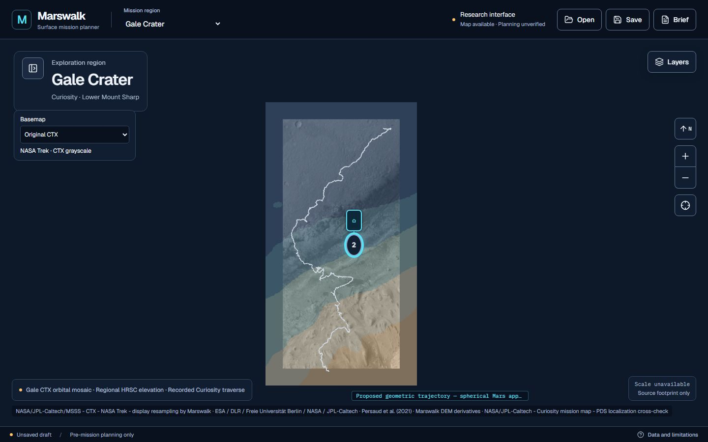
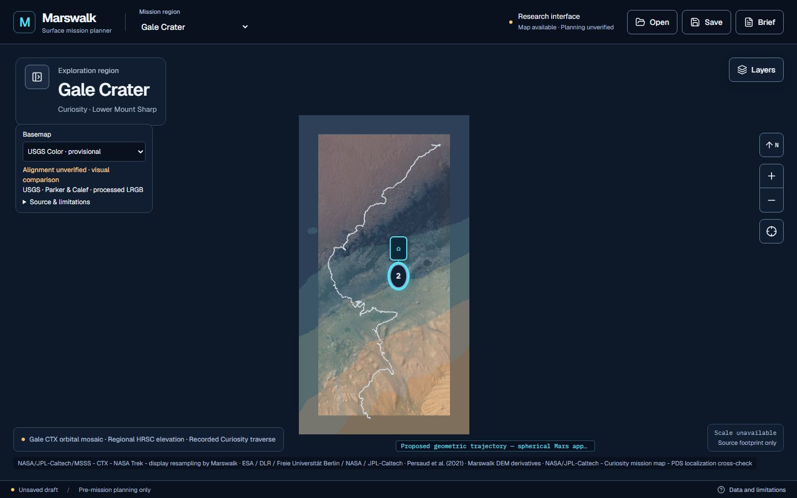
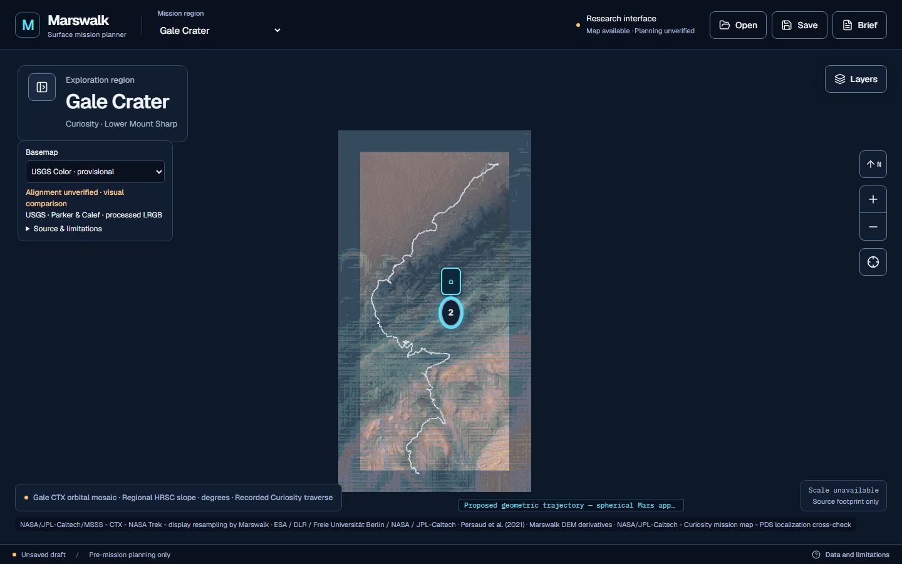
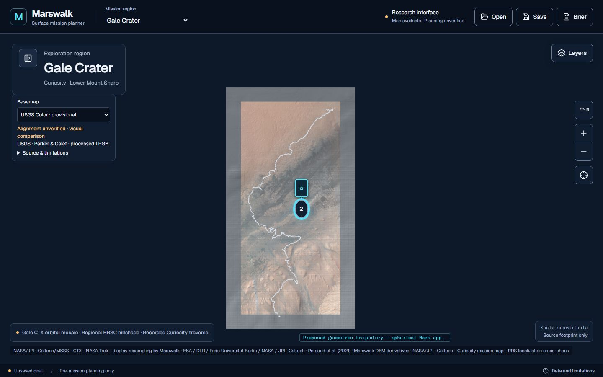
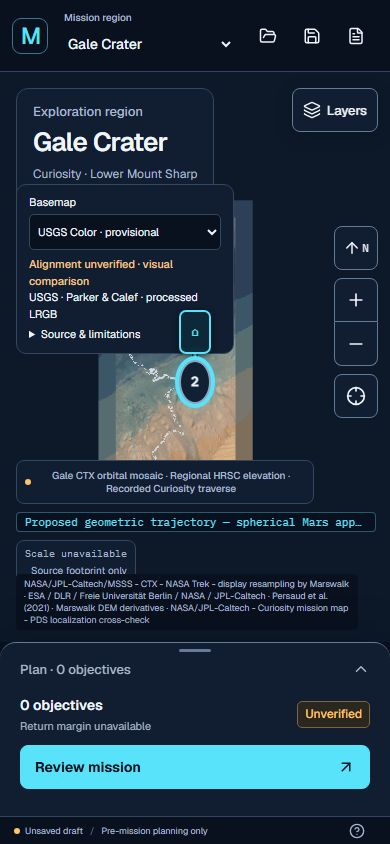

# Gale G4 + G5 integration and scientific audit

Reviewed 14 November 2026, Asia/Rangoon. This integration combines authentic
regional terrain and provisional processed color without operational terrain
routing, safety classification or claimed precise optical co-registration.
No deployment was performed.

## Baseline, isolation and merge history

Remote references were fetched before integration. Both feature tips matched
the user-verified deliveries and share exactly the original development base:

| Input | Exact commit |
| --- | --- |
| Current shared baseline | `a5809dad9ed0f52c0604f3a00c327b666d8d95e2` |
| G5 processed color | `1969df9ce559bf88f0c119309f5d35fdeb4f18c4` |
| G4 regional terrain | `65c95adae305cd869cf7a50f06cd59e857bce800` |
| First normal merge, G5 | `816587c2600c6d0b259eb2cec9b03d764854cc84` |
| Second normal merge, G4 | `3fda4ed2b59f8dea0942979515ed939c24af6e22` |
| Verified scientific/compatibility integration | `5b83d230822e39dfa5334c00878dcac6168ce2f7` |

Branch `integration/gale-g4-g5` was created in the new worktree
`D:\martian-map\output\gale-g1\output\gale-g4-g5-integration`, from the fetched
`origin/feat/gale-map`. Both `--no-ff` merges were conflict-free. Original feature
history remains intact. Scientific and compatibility fixes are subsequent
commits; no feature branch was rewritten or deleted.

The main working tree had an existing uncommitted
`components/map/map-workspace.tsx` edit at inventory time. It was not touched.
The other existing worktrees were clean. No branch switches, resets, cleaning,
stashing, weather changes or unfinished Jezero/Oxia merges were performed.
The fetched Oxia remote had advanced independently; it was not integrated.

`feat/gale-map` remains protected until every gate below passes. Its local and
remote tips are checked again immediately before the final fast-forward; any
concurrent change stops that update. `main` is never a write target.

## Preserved geography and scientific scope

Configured overview is unchanged:
`137.3442352329006 .. 137.4579431096443° E`,
`−4.822361175063087 .. −4.580605407446296° N`.
Planetocentric latitude, east-positive 0–360 longitude storage and the Mars
sphere radius **3,396,190 m** are preserved. Initial regional center and explicit
Fit/reset equations are unchanged.

Original CTX tiles, PDS elevation derivatives, Arc Pass polygons, traverse,
science targets, mission serialization, spherical geodesy, waypoint engine and
Jezero/Oxia files have no changes from the shared baseline. G5 imagery tiles and
source transformation are unchanged from their delivery. The one scientific
raster correction below restores the actual USGS global source affine in its
derived subset; it does not adjust an observation to fit another image.

## A — Neutral elevation legends

Regional elevation labels formerly associated numeric height bins with clay,
Vera Rubin Ridge and sulfate-bearing strata. Those unsupported interpretations
are replaced with lowest/lower/intermediate/higher/highest elevation classes.
Thresholds **−4400, −4200, −3900, −3500 m**, colors and height values are unchanged.
Independent mapped geological classifications and geometry remain untouched.
The original G4 report is corrected to use the same neutral terminology.

## B — Layer compatibility and camera behavior

Inspection found that G4's report described a changed `updateLayerState`, but
its implementation actually matches the baseline. The inherited blanket rule
still made terrain and geology exclusive. The integration changes Gale only:

- The nine local/regional/global terrain products are alternative thematic
  views, with one selected at a time. This prevents competing source/quantity
  legends and superposed opaque terrain products.
- Geology, optical imagery, recorded traverse and scientific/waypoint overlays
  remain independent. Terrain and geology coexist in either activation order.
- Jezero and Oxia keep their original availability and visibility policy,
  verified with explicit regression fixtures and real region-switch tests.
- Existing state and opacity values are retained. Basemap selection does not
  modify terrain state; terrain selection does not modify basemap state.

All terrain `focus_extent` hints are removed, including the legacy PDS hints,
so toggling a terrain product cannot move the current camera. Source request
bounds are retained. Opening Gale's Layers panel now retains the current view
rather than allowing mobile sheet resize to refit against changing legend
furniture. This is a narrow MapWorkspace callback change. Explicit Fit/reset,
initial overview and other regions' behavior remain unchanged. The independent
geology focus behavior is retained.

The PDS visual regression test now navigates explicitly to the same audited
local footprint before its original pixel assertions. No original visual
threshold is reduced. Older Node assertions describing blanket exclusion and
automatic terrain focus are replaced with the requested terrain-only grouping,
independent geology preservation and no-focus assertions.

## C — Independent source audit found a global affine error

The G4 global extractor used `360 / 106694` as longitude and latitude spacing.
The original remote TIFF does not span exactly 360 degrees at that raster
width. Its inspected GeoTIFF affine is authoritative:

```text
Source width / height: 106694 / 53347
Actual step:     0.003374120830641 degrees
Old assumption:  0.0033741353778094364 degrees
Source origin:   longitude −180°, latitude 90°
Source type:     signed int16, NoData −32768
Source sphere:   3,396,190 m
```

At the old cached subset origin, this creates approximately **0.405 source
columns and 0.120 source rows** of computational placement discrepancy. This is
about 81 m east and 24 m south in the source angular-grid metric; it is **not** a
measured absolute or CTX-relative accuracy bound.

[Original-source verification](../team/gale/verify_g4_global_source.py) reads
only **1,049,650 bytes**: a 1 MiB header prefix and three 358-byte row segments.
It validates HTTP byte ranges, object identity, actual TIFF encoding, CRS,
affine and NoData. **537 native DN values** match the cached subset at the
documented integer window `(column=93979, row=27947, width=179, height=238)`.
The corrected subset affine is exactly:

```text
original_global_affine × translation(93979, 27947)
```

The native value array SHA-256 remains
`8cf6fbedf710da94d5a23cb9ad0e45572c017b10c0dc25521a9311a57af2bb49`
before and after metadata repair. Original source TIFF bytes and G4's source
worktree are untouched. Only this integration worktree's derived copy,
reproducible extraction/preparation code, global tile pack, coverage polygon
and actual source bounds are corrected. No arbitrary image translation, fitted
offset, source DN alteration or Earth reference surface is introduced.

[Pinned evidence](../team/gale/sources/integration/global-source-check.json)
records the original object, header hash, native samples and both affines. The
global object is **11,384,463,908 bytes**, with ETag
`94ec792407f5a3da2f8b87aba42613eb-1358`; this multipart ETag is not called a
full-file cryptographic checksum. Only bounded source ranges are authenticated.
The actual global geographic grid is used, without an authority-code shortcut.

The cached 311.8 MB regional HRSC file matches the published MD5
`1d714f2142a56e962d50d985b7088b13` and SHA-256
`ed1fd5cd080a62eff7d2b9f38110c0a2c62ee05a4706ac0b45d015043e781ae6`.
Its declared spherical equirectangular grid, actual 30 m affine, finite data and
NoData mask are inspected. All **210 regional tile hashes remain identical**.
All 1,305 global tiles were regenerated; **1,113 hashes change**, with the same
tile paths/count. The original extraction/preparation implementation is fixed
for future regeneration, including bounded-response and source-identity guards.

## Coverage, processing scales and uncertainty

Coverage percentages are now calculated from actual valid masks using spherical
cell-footprint intersection with fractional overview edges. Rectangular source
envelopes alone are not accepted as validity. Derivative masks require all nine
Horn neighbors. Existing source affines and masks determine every measurement.

| Product | Native valid footprint in overview | Derived valid footprint | Analysis cells in buffered derivative window |
| --- | --- | --- | --- |
| Local PDS subset | 1.0353254%, approximately 1.04% | Existing audited subset | 1,600 |
| Regional HRSC 30 m | 100% | 100% | 158,013 |
| Global nominal 200 m | 100% | 100% | 41,772 |

The overview's spherical area is approximately **96.259 km²**. Buffered cell
counts are not cells wholly inside the overview. Source grid spacing is not
effective observational resolution or positional accuracy.

- PDS uses 25 m complete-post averages / 75 m gradient support from a mixed
  source 1 m grid. Uniform native 1 m detail is not claimed.
- Regional HRSC uses a 30 m grid / 90 m Horn support.
- Global HRSC–MOLA uses nominal 200 m grid / approximately 600 m support.
- Heights retain the reported MOLA areoid reference and positive-up convention.
  No new vertical error bound is established.
- Derivatives use `p=dz/dEast`, `q=dz/dNorth`, Mars metre spacing with
  east-distance `cos(planetocentric latitude)`, Horn slope and artificial
  315° azimuth / 45° altitude illumination. No acquisition-time lighting,
  cast-shadow or atmospheric model is implied.

The false combined “0% fabricated/interpolated pixels” field is withdrawn.
The pipeline adds no gap filling, but explicitly resamples: destination XYZ
pixel centers are inverse-mapped into the native-derived grid with nearest
neighbor; GPU terrain resampling is nearest. Repeated display pixels are not
independent observations. Upstream stereo reconstruction/blending/interpolation
is not audited as zero interpolation. The G4 report's unsupported 20–50 m
registration range and zero-client-CPU/instant-loading claim are withdrawn.

Prepared tile alpha is measured independently. All six G4 products cover **100%
of the overview at their finest prepared z13**. G5's native mask remains 100%
valid, while its prepared z15 alpha covers **99.9718748%** of the exact spherical
overview: destination-center clipping leaves tiny fractional edge slivers.
Those are display-boundary quantization, not measured native NoData holes; CTX
remains underneath as fallback. This metric precedes GPU resampling at arbitrary
zoom. No missing color support is fabricated.

**Independent local DEM/CTX/color registration remains unverified.** No image
control fit or positional uncertainty bound is added. Color remains labelled
provisional and processed, not guaranteed human-eye true color or uniform native
25 cm detail. Safety, hazard classification and operational terrain routing
remain unavailable. The readiness status stays partial for scientific quality
and registration, with its reason corrected to acknowledge full regional grid
coverage rather than falsely saying only the local PDS subset exists.

## Runtime assets and production compatibility

[HTTP verification](../scripts/verify-gale-runtime.py) checks every actual Gale
map/photo runtime file against local bytes, and all G4/G5 tiles against published
manifests. [Results](../team/gale/sources/integration/runtime-assets.json):

| Pack | Tiles | Encoded image bytes |
| --- | --- | --- |
| Regional terrain | 210 | 552,479 |
| Corrected global terrain | 1,305 | 1,255,162 |
| Combined G4 | **1,515** | **1,807,641** |
| G5 processed color | **357** | **21,482,684** |
| G4 + G5 tile additions | **1,872** | **23,290,325** |

**1,953 runtime files / 26,216,593 bytes** pass HTTP 200 and exact content-hash
checks. Two `.gitattributes` files are Git-control data, not runtime assets;
Next deliberately does not serve dotfiles. All declared runtime paths resolve
from `public/`. No tracked source TIFF, ignored scientific cache or external
raster host is required to run the built app. No deployment was performed.

Layer order is CTX fallback, optional processed color, terrain, geological/
scientific overlays, trajectories and interactive DOM markers. Actual rendered
tests verify CTX and color with all six G4 products; terrain opacity zero
recovers the exact same color framebuffer. Geology visibly composites above
regional terrain and color. Missing color restores CTX without corrupting the
terrain, waypoint projections or navigation. Two noncoincident waypoint marker
projections and exported mission JSON remain identical through switches at the
same canvas dimensions. Region changes remove Gale sources; returning retains
the Gale mission while the optional color selector starts at CTX.

## Combined verification

All test files are included; no assertion thresholds are reduced and no
scientific test is omitted. The complete production browser run finished in
**6.3 minutes**:

| Gate | Result |
| --- | --- |
| All Node/TypeScript test files | 164 passed, 19 suites, 0 skipped |
| All Gale Python scientific tests | 37 passed, 0 skipped |
| Typecheck | Passed |
| ESLint | Passed, no warnings |
| Production build | Passed |
| Every runtime map/photo file over HTTP | 1,953 passed, 0 failures |
| Full Playwright production run | 69 passed, 0 failed, 0 skipped |

The browser union is 49 baseline + 4 G4 + 7 G5 + 9 new combined scenarios.
Chromium runs at 1440, 1024, 768 and 390 px. New scenarios exercise actual
compositing, opacity, exact mission JSON preservation, M3 geometry/numbering,
camera preservation, missing-color fallback, geology coexistence and region
isolation. Existing accessibility scans cover the waypoint editor and all
responsive views; new control scans pass. No horizontal overflow is allowed.

Initial targeted checks exposed a mobile PDS test setup depending on automatic
camera focus, a new export-test dialog selection error, and mobile layer-sheet
refitting. The PDS test explicitly navigates before retaining its old thresholds;
the export test uses the existing Saved Missions dialog; the mobile refit was
fixed in the Gale Layers callback. Full-run outcomes supersede those diagnostic
failures; failures are never hidden from a reported final total.

## Actual application screenshots

Captured directly by Playwright as JPEG (quality 80), without generated artwork.
CTX and color regional pairs use identical camera, viewport and waypoint state.







## Reproduction

Ordinary runtime requires only the normal locked Node setup and committed
static assets. Scientific source rasters are needed only for full processing
replay. Reuse the pinned caches where available.

```powershell
npm.cmd ci
npx.cmd tsx --test tests/*.test.ts
python -B -m unittest discover -s tests -p 'test_gale_*.py' -v
npm.cmd run typecheck
npm.cmd run lint
npm.cmd run build
# Separate terminal, same isolated checkout:
npm.cmd run start -- --port 3124
# Against that server:
$env:PLAYWRIGHT_BASE_URL='http://127.0.0.1:3124'
npx.cmd playwright test
python -B scripts/verify-gale-runtime.py --base-url http://127.0.0.1:3124
```

Processing replay:

```powershell
# G4 source rasters under ignored output/g4/raw; use the existing downloader
# only when the full regional source is absent. Do not fetch the full global DEM.
python -B team/gale/extract_usgs_200m.py
python -B team/gale/verify_g4_global_source.py --download
# For a copied legacy G4 subset only, add --repair-subset after DN validation.
python -B team/gale/prepare_g4_terrain.py
# Subsequent original-source verification uses pinned cached ranges, no network:
python -B team/gale/verify_g4_global_source.py
```

The subset container hash can depend on GeoTIFF metadata-writing history; the
canonical native DN hash, source affine and derived tile hashes bind numerical
reproducibility. G5 reproduction remains documented in its unchanged source
preparation README. No G5 Phase 3 work or broad grayscale extraction is started.

## Primary references and delivery status

- [Persaud, Putri and Muller (2021), 30 m HRSC DTM](https://zenodo.org/records/5808354):
  actual source CRS, grid spacing, HRSC strips and HRSC–MOLA terrain reference.
- [USGS HRSC–MOLA product catalogue](https://astrogeology.usgs.gov/search/map/mars_mgs_mola_mex_hrsc_blended_dem_global_200m):
  source lineage; the binary metadata/range checks above provide file evidence.
- [G4 audit](../team/gale/G4_TERRAIN_AUDIT.json) and corrected
  [G4 report](GALE_REGIONAL_TERRAIN_EXPANSION_REPORT.md).
- [G5 source/integration report](GALE_COLOR_BASEMAP_INTEGRATION_REPORT.md).

The application remains a scientifically qualified exploration and geometric
planning visualization. Source validity and this computational affine repair do
not certify independent optical alignment, effective fine-scale resolution,
astronaut safety or terrain-aware operational planning.

All gates passed against the application committed as
**`5b83d230822e39dfa5334c00878dcac6168ce2f7`**. The subsequent report/screenshots
commit changes documentation only. After a fresh fetch, both the local and
remote shared branch still matched `a5809dad9ed0f52c0604f3a00c327b666d8d95e2`,
the shared worktree was clean, and both remote feature tips still matched the
input table. Publication is the final gated operation, with a further remote
check and normal fast-forward push; its confirmed SHA is recorded in the final
delivery response. The final delivery commit contains this report; resolve it with
`git log -1 --format=%H -- docs/GALE_G4_G5_INTEGRATION_REPORT.md`. The delivery
response gives the exact final `feat/gale-map` SHA and clean/synchronized status.
