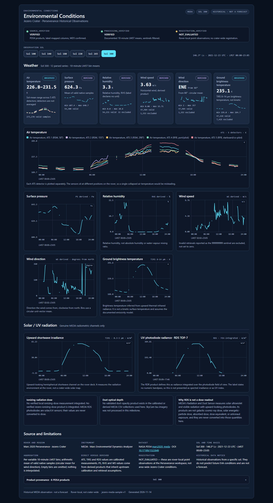
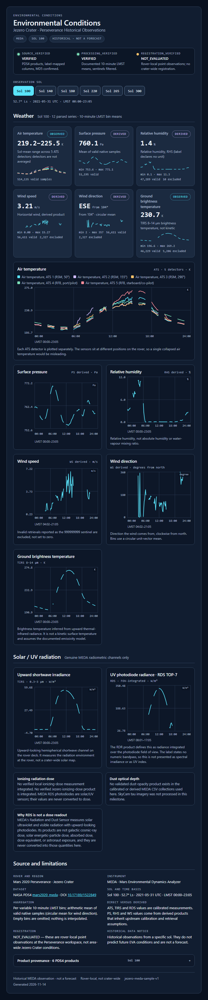
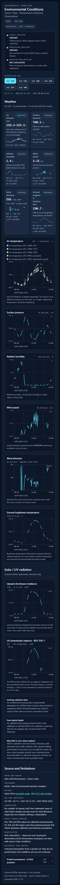

# Jezero Crater Environmental Conditions — Delivery Report

**Workstream:** Jezero historical environmental observations
**Branch:** `feat/jezero-historical-weather`
**Region:** Jezero Crater, Mars 2020 Perseverance
**Instrument:** MEDA (Mars Environmental Dynamics Analyzer)
**Status:** Implemented, validated, screenshotted, pushed. Not merged.

---

## 1. What was delivered

A standalone, independently importable environmental-conditions module that
presents **real Perseverance MEDA observations** for six sols, plus a
reproducible ingestion pipeline, a typed data layer, a shared-contract adapter,
tests, screenshots, and this report.

The panel shows, per sol:

- air temperature from **five separate ATS detectors** (never collapsed),
- surface pressure (PS, derived),
- relative humidity (RHS, derived),
- horizontal wind speed and direction (WS, derived),
- ground **brightness** temperature (TIRS, 8–14 µm),
- upward shortwave irradiance (TIRS, 0.3–3 µm),
- RDS TOP-7 photodiode radiance (FOV-integrated, W/m²),

and explicitly reports **dust optical depth** and **ionizing radiation dose** as
unavailable. No Gale RAD value is substituted, and no RDS value is converted to
dose.

All numbers in the committed dataset are traceable to a named PDS4 product,
version, record count, and checksum.

---

## 2. Baseline and delivery commits

| Item | Value |
| --- | --- |
| Repository | `https://github.com/KaungSet178/Martian-Map` |
| Starting SHA (`origin/main`) | `b6cc52dc48f459904543ce68c94dc11d6b4e8800` |
| Worktree | `D:\martian-map-jezero-environment` |
| Implementation commit | `47738ad43bfa44fc2da75e129d17ecb4eb7a8314` |
| Documentation commit | This report, committed immediately after the implementation commit |
| Branch head after push | Reported in the delivery message; verify with `git ls-remote origin feat/jezero-historical-weather` |
| Merge status | Not merged into `main`; no other agent branch modified |

The implementation commit contains the code, dataset, tests, screenshots, and
the workstream README. This report is a documentation-only commit on top of it,
so the artifact SHA above is stable and reproducible.

---

## 3. Source inventory

| Item | Value |
| --- | --- |
| Bundle | NASA PDS4 `mars2020_meda` |
| Bundle URL | <https://atmos.nmsu.edu/PDS/data/PDS4/Mars2020/mars2020_meda/> |
| Dataset DOI | [10.17189/1522849](https://doi.org/10.17189/1522849) |
| Calibrated collection | `data_calibrated_env` |
| Derived collection | `data_derived_env` |
| Products used | `CAL_ATS`, `CAL_TIRS`, `CAL_RDS`, `DER_PS`, `DER_RHS`, `DER_WS` |
| PDS4 releases observed in labels | 2, 3 and 4 (varies by sol/product; recorded per product below) |
| Fetch date | 2026-11-14 |
| Raw download cache | `team/environment/jezero/cache/` (git-ignored, ≈100 MB) |
| Machine-readable manifest | `team/environment/jezero/cache/download_manifest.json` |

For every product the pipeline downloaded both the PDS4 label (`.xml`) and the
data table (`.CSV`), selected the **highest version present for that sol**, and
verified the CSV against the `MD5` declared inside the label before parsing.
Downloads are atomic (`.part` → rename) and retried on truncation.

Documentation used to interpret the fields: the MEDA RDR Software Interface
Specification text extracted from the bundle
(`team/environment/jezero/cache/rdr_sis.txt`), plus each product's PDS4 label
field definitions.

---

## 4. Selected products and checksums

Download link rule:

```
{directory}/{PRODUCT_ID}.CSV
{directory}/{PRODUCT_ID}.xml      (label)
```

Per-sol directories:

| Sol | Calibrated directory | Derived directory |
| --- | --- | --- |
| 100 | `.../data_calibrated_env/sol_0090_0179/sol_0100/` | `.../data_derived_env/sol_0090_0179/sol_0100/` |
| 140 | `.../data_calibrated_env/sol_0090_0179/sol_0140/` | `.../data_derived_env/sol_0090_0179/sol_0140/` |
| 180 | `.../data_calibrated_env/sol_0180_0299/sol_0180/` | `.../data_derived_env/sol_0180_0299/sol_0180/` |
| 220 | `.../data_calibrated_env/sol_0180_0299/sol_0220/` | `.../data_derived_env/sol_0180_0299/sol_0220/` |
| 265 | `.../data_calibrated_env/sol_0180_0299/sol_0265/` | `.../data_derived_env/sol_0180_0299/sol_0265/` |
| 300 | `.../data_calibrated_env/sol_0300_0419/sol_0300/` | `.../data_derived_env/sol_0300_0419/sol_0300/` |

where `...` is `https://atmos.nmsu.edu/PDS/data/PDS4/Mars2020/mars2020_meda`.

`MD5` is the value declared in the PDS4 label and re-checked after download;
`SHA-256` is computed locally over the exact CSV bytes that were parsed.

### Sol 100 — 2021-05-31T22:23:00Z → 2021-06-01T22:06:29Z, Ls 52.734° → 53.170°

| Product | Ver | Rel | Records | Bytes | MD5 | SHA-256 |
| --- | --- | --- | ---: | ---: | --- | --- |
| `WE__0100___________CAL_ATS_________________P01` | 1.0 | 2 | 102,828 | 8,226,257 | `065af13f3d3bf9af7726a4b8b3549c2a` | `c60896719cdee316f3e98289048f668ce71cba95ee094cd3eaa9ff1cab5ec77e` |
| `WE__0100___________CAL_TIRS________________P03` | 3.0 | 2 | 51,436 | 5,869,728 | `9c4c3d392085b431d6f71f39d34c3951` | `d3618045d73a1413e460c2c734e060cae8de00f08567dacde87f235dbb692292` |
| `WE__0100___________CAL_RDS_________________P01` | 1.0 | 2 | 51,229 | 12,757,251 | `17d42479b2eb2d722f1684dddbbb60ba` | `131ea0d31ef47a6fc91348d9989ecaead1b654a87457083bd9c367a7efb1173f` |
| `WE__0100___________DER_PS__________________P01` | 1.0 | 2 | 51,196 | 2,764,587 | `803fbdbdb34b1ea5b099139f406095fb` | `76e4e85d2729f4ce32ee2248a42e087d6fe2f6bc4312b2692dff63ce29352768` |
| `WE__0100___________DER_RHS_________________P02` | 2.0 | 2 | 47,300 | 3,080,959 | `82be0a19a5feb83c2317b8dd5434bf30` | `b3b16d66b2b3d9a7196dc530292e946bb5b58cbdba187215e04ce617bbb5141e` |
| `WE__0100___________DER_WS__________________P02` | 2.0 | 3 | 58,939 | 3,776,206 | `500fec3ba1b56efc6a8522250692a3d4` | `05289eec904f3101ce9a3878fccf146c97ed03ed3f01667819da8f23f54cb4f9` |

### Sol 140 — 2021-07-12T00:46:30Z → 2021-07-13T00:30:16Z, Ls 70.737° → 71.169°

| Product | Ver | Rel | Records | Bytes | MD5 | SHA-256 |
| --- | --- | --- | ---: | ---: | --- | --- |
| `WE__0140___________CAL_ATS_________________P01` | 1.0 | 2 | 97,018 | 7,761,457 | `ae3b3f64097accb8ef651b021d880fd7` | `585e67659aa6a2859fe22099aa38c922a163dbebfb7daa5c88f4145f68e15b2e` |
| `WE__0140___________CAL_TIRS________________P03` | 3.0 | 2 | 48,511 | 5,520,211 | `a01eeb18d12613b0a5d09c5b27da33c1` | `58c8a25a0fd72b7b7434fe2a75ccaeddd234752607db6068ac479846e96fcf18` |
| `WE__0140___________CAL_RDS_________________P01` | 1.0 | 2 | 48,291 | 11,966,511 | `11610601fd027f1d24c70a3c361b02c4` | `113c9f36faff73eca71fdddc6c3ef4f86da55eb606a037ad5fa56ddcd5a9af75` |
| `WE__0140___________DER_PS__________________P01` | 1.0 | 2 | 48,190 | 2,602,263 | `e76b20058541bed0b338a012b5a39155` | `c2e70bd8c31c03d91152ef8532ec14491a5b9d49fdad38328c5afecf5238bb50` |
| `WE__0140___________DER_RHS_________________P02` | 2.0 | 2 | 44,159 | 2,853,282 | `6b53224988170077fc0c6702572b8920` | `ddf11ddf986bbf60e3d1ba2b3b3e4a405dc6e0968e141a726a60f9cd2e5ab3b9` |
| `WE__0140___________DER_WS__________________P02` | 2.0 | 3 | 55,680 | 3,567,420 | `aadea87ab4915c3480b455798bbc59b9` | `c11ff34ce80e3809a7d0621d44f3ce5f54e3ac98ab55e522b0c2cd0ac6c408fc` |

### Sol 180 — 2021-08-22T03:09:59Z → 2021-08-23T02:53:47Z, Ls 88.731° → 89.167°

| Product | Ver | Rel | Records | Bytes | MD5 | SHA-256 |
| --- | --- | --- | ---: | ---: | --- | --- |
| `WE__0180___________CAL_ATS_________________P02` | 2.0 | 3 | 48,059 | 3,796,678 | `d2c66417bb2a716e258fef563abc8ced` | `d4f778bae36942dbb5f423bdf843bb94b08f0d10b2b797ebb325ac935491bfe9` |
| `WE__0180___________CAL_TIRS________________P03` | 3.0 | 3 | 48,058 | 5,486,069 | `afacb7472dc42ae54bb81d91f9e86924` | `442b879053f86b33b10cbca02c77eb7ed052a3bb8b713796186e7f40ea29edf8` |
| `WE__0180___________CAL_RDS_________________P03` | 3.0 | 3 | 47,840 | 11,930,711 | `5215c78af78e6983d835e6fa41c8cae8` | `4cc8bb15e247c607a2daeaabcd0e51fcca9e44c0cd95167936c876c94225f2e7` |
| `WE__0180___________DER_PS__________________P02` | 2.0 | 3 | 47,671 | 2,574,237 | `5cc22811c5eb9fb028b6eb45fcbb29d1` | `17f8069bbaed96676c9a72d728fa7d2ce7f6dd23a85de383ab5fd3195f7034a0` |
| `WE__0180___________DER_RHS_________________P02` | 2.0 | 3 | 40,159 | 2,591,931 | `b1d08100b744f255d66e5630b7944917` | `aa6cc5f25b0e398c3617948cdf4f34911f1d5bebf5cdad61f4d207691abf9e2a` |
| `WE__0180___________DER_WS__________________P03` | 3.0 | 3 | 42,841 | 2,700,384 | `5aa4788e3dd76d70481a92788eed0a85` | `ef688935922a94c17703d7cebfd2220af14a43619b879363fa4924d3347ef87f` |

### Sol 220 — 2021-10-02T05:33:32Z → 2021-10-03T06:13:04Z, Ls 107.079° → 107.545°

| Product | Ver | Rel | Records | Bytes | MD5 | SHA-256 |
| --- | --- | --- | ---: | ---: | --- | --- |
| `WE__0220___________CAL_ATS_________________P02` | 2.0 | 3 | 48,025 | 3,793,992 | `f7d3c633df860f9c3d0f81e8d1c77d0b` | `ccd915e5500b10a8232a110350269be04c456a56ec2bd8e2a35c46a6b13792b1` |
| `WE__0220___________CAL_TIRS________________P03` | 3.0 | 3 | 48,024 | 5,469,544 | `536d541da4426b521fae397d95708c9e` | `1879051116d69afea5a76febed17d39b279d61204c01b5d27aebdd9e4f67a06b` |
| `WE__0220___________CAL_RDS_________________P01` | 1.0 | 3 | 47,902 | 11,916,689 | `6e025269ccd7634f2012444ad43213e9` | `52fcc86bfd8fe5c31ca0e6558886654eba9dd303fa1e8ddfc84d35ecac318ae3` |
| `WE__0220___________DER_PS__________________P01` | 1.0 | 3 | 47,818 | 2,582,175 | `7fdef859ae7685dda4e4a640d604817d` | `a0d3ca01c90b60222adc0e73b862f927256231abef9fdc3a6656e62a513ab092` |
| `WE__0220___________DER_RHS_________________P02` | 2.0 | 3 | 47,774 | 3,130,748 | `666d6dff7bf6a2007c134f5eb20a9dc5` | `82ae61aaa50f643b535a9d342b3a620b40e7b54a5f774f8b153eb7919ccf7686` |
| `WE__0220___________DER_WS__________________P02` | 2.0 | 3 | 47,120 | 2,963,515 | `0aacebc8162e82c4164c5ba8409976fb` | `a11676362d65c132115537ad9b817d220adf4d899328342c58bc27327dd705e6` |

### Sol 265 — 2021-11-17T11:14:59Z → 2021-11-18T11:54:29Z, Ls 128.596° → 129.089°

| Product | Ver | Rel | Records | Bytes | MD5 | SHA-256 |
| --- | --- | --- | ---: | ---: | --- | --- |
| `WE__0265___________CAL_ATS_________________P01` | 1.0 | 3 | 51,466 | 4,065,831 | `dfcebf1ccdbf859e5875e7e3c5d07aab` | `3778ebafebf534fb4ced3d384093d7f97fa09e43ef034e0c48bfd1c1b191b77f` |
| `WE__0265___________CAL_TIRS________________P03` | 3.0 | 3 | 51,463 | 5,855,583 | `f0f4104e15a908f48bf58c12ac1d9a6a` | `84b6ba653227c3cb1bd488e0c50aec3bde5b9daa6c5002c15be5e21645fc926d` |
| `WE__0265___________CAL_RDS_________________P01` | 1.0 | 3 | 51,248 | 12,768,118 | `6694bcd80961b5348329f55f2bdf655d` | `656f2bf22726b11b390f78ff8261c109a81fa83eca4d9767549a949ddc7539a9` |
| `WE__0265___________DER_PS__________________P01` | 1.0 | 3 | 51,106 | 2,759,727 | `11f6049eca16578152e64d227198b7b4` | `977c4bdd1b4d7910852efa7c8a6e87593ee8b9327cd1670c9250a3a799c44a44` |
| `WE__0265___________DER_RHS_________________P02` | 2.0 | 3 | 36,431 | 2,359,905 | `5965f8a7c5873660b240c013822bb33e` | `d3da8ce5d29a7636e61cfcf306784c6407e5ea41ce95d30e328ee28288065948` |
| `WE__0265___________DER_WS__________________P02` | 2.0 | 3 | 42,560 | 2,681,867 | `16fc2951095129b72002d965178b8d7b` | `aebd70e4a4e05e05656f30c6a980a94008f163d57e7fd6deda9829cffd146ec3` |

### Sol 300 — 2021-12-23T10:20:29Z → 2021-12-24T10:04:15Z, Ls 146.284° → 146.785°

| Product | Ver | Rel | Records | Bytes | MD5 | SHA-256 |
| --- | --- | --- | ---: | ---: | --- | --- |
| `WE__0300___________CAL_ATS_________________P01` | 1.0 | 4 | 54,655 | 4,317,762 | `1e9ae5c028831d59b9fa20039cef8b84` | `c77ad13c75c4600009475065fecfd7b4be851c6614c667dae9fa2f820827b7ce` |
| `WE__0300___________CAL_TIRS________________P02` | 2.0 | 4 | 54,654 | 6,242,247 | `bc7f7825b73245df073e2eb6f2cb951a` | `9b3ba13ab9764d222acb477e1e650e6b84a1c6e9777e2fe66ccd3892be952b46` |
| `WE__0300___________CAL_RDS_________________P01` | 1.0 | 4 | 54,425 | 13,520,885 | `f4640e9653cfe8d670e571f7ead45bf8` | `8f8166a27a7b36ec256b5516405d6cb67f5113edd69c88c2b23dac5d59c30ab8` |
| `WE__0300___________DER_PS__________________P01` | 1.0 | 4 | 54,301 | 2,932,257 | `840dc530101cea0ca28a21a91f9c66a1` | `4ab0e74689c238e56d31b40a0f3fe1fdc2a28d4cbeb1190d7738720d49fc3696` |
| `WE__0300___________DER_RHS_________________P01` | 1.0 | 4 | 54,243 | 3,565,656 | `16101ef055d0da9f48ac555ed66d03f9` | `12d4abcda2c98230065ac824004143a15f5912e9a4001bf51a77084580c6cda6` |
| `WE__0300___________DER_WS__________________P01` | 1.0 | 4 | 49,338 | 3,096,635 | `feac3db065338388e46874264644f6a4` | `37dc2537a9c117830f65976f43a613ef60309884879583aca2763a84898d4998` |

**Sol selection rule.** Six sols inside 36–315: the only interval in this PDS
release with a derived wind product, and after the sol-63 humidity
commissioning limit. Sol 260 was rejected because the wind product is absent
(404) on that sol; sol 265 was used instead. Products that are missing for a
sol are reported as gaps, never filled.

---

## 5. Processing method

Pipeline: `team/environment/jezero/fetch_meda.py` → `build_dataset.py`.

### 5.1 Download and integrity

1. List each sol directory for the six sensor tokens; tolerate HTTP 404
   (product absent for that sol) as a documented gap.
2. Choose the highest `_Pxx` version present.
3. Download the label and CSV with retries, Content-Length checks, and atomic
   rename from `.part`.
4. Parse `MD5` and `file_size` from the PDS4 label and verify both.
5. Write a manifest entry per product (URL, sizes, SHA-256, label metadata,
   field names/units, release number). The manifest is rewritten after each
   sol so an interrupted run keeps verified work.

### 5.2 Parsing and validation

- Required columns are checked against both the CSV header and the PDS4 label
  field list, normalized for whitespace/case.
- The full header is **not** required to match the label textually. The
  published `DER_RHS` label contains two name typos in **unselected**
  uncertainty columns (`LOCAL_TEMP_UNCERTAINTY`,
  `VOLUME_MIXING_RATION_UNCERTAINTY`); the build prints a warning and continues.
  Every column that is actually parsed must be present in both.
- `LMST` must match the documented `SSSSS Mhh:mm:ss.sss` form; the sol prefix
  is cross-checked against the product's sol.
- Numeric cells accept blanks, `NaN`, `Inf` and the MEDA sentinel
  `999999999` as **missing**, never as zero.

### 5.3 Row-level exclusions

| Product | Exclusion |
| --- | --- |
| `CAL_TIRS` ground | Rows with `TIRS_GROUND_FOOTPRINT_NOT_IN_SHADOW = 0` are dropped; the remaining rows are unshadowed ground footprints. |
| `CAL_RDS` | Only regular-mode rows are used. High-gain values live in separate `_HG` columns that are blank for regular-mode rows, so the two gain modes are never mixed. |
| `DER_WS` | Rows whose speed/direction is the `999999999` sentinel are dropped. |
| All | Blank/non-finite values are dropped per variable, not per row. |

### 5.4 Aggregation

- Time basis: **LMST**, seconds after local mean solar midnight, from the
  product's own `LMST` column. No UTC conversion is invented per sample.
- Bins: fixed **600 s (10 min)** bins aligned to LMST midnight.
- Value: arithmetic mean of valid 1 Hz native samples in the bin.
- Wind direction: **circular unit-vector mean**, then normalized to
  `[0, 360)`. Speed remains a scalar arithmetic mean.
- Empty bins are **omitted**. No interpolation, no forward fill, no
  placeholder zero.
- Each bin stores `n` (valid native samples), `lo`/`hi` (min/max inside the
  bin), and the bin-start time.
- Series summaries report native samples read, valid samples used, excluded
  samples, min/max, mean, and first/last LMST.

### 5.5 Derived statistics are labelled as such

Every bin value is a derived statistic. The adapter records it explicitly:

> `arithmetic mean of N valid native samples in a 10-minute LMST bin; no interpolation.`

The panel labels `Observed` for ATS/TIRS/RDS (calibrated products) and
`Derived` for PS/RHS/WS (derived products). The dataset header records
`sourceVerified = VERIFIED`, `processingVerified = VERIFIED`,
`registrationVerified = NOT_EVALUATED`.

### 5.6 Units

| Quantity | Unit | Source |
| --- | --- | --- |
| Air temperature | K | `ATS_LOCAL_TEMP1..5`, label unit `kelvin` |
| Surface pressure | Pa | `PRESSURE`, label unit `pascal` |
| Relative humidity | % | `LOCAL_RELATIVE_HUMIDITY`, label declares **no unit**; `%` is retained with a `unitNote` |
| Wind speed | m/s | `HORIZONTAL_WIND_SPEED`, label unit `meter/second` |
| Wind direction | degree | `WIND_DIRECTION`; direction the wind comes **from**, clockwise from north |
| Ground brightness temperature | K | `GROUND_TEMP`, 8–14 µm |
| Upward shortwave irradiance | W/m² | `UPWARD_SW_IRRADIANCE`, 0.3–3 µm |
| RDS TOP-7 radiance | W/m² | `RDS_TOP_7`, FOV-integrated; label states no numeric bandpass |

---

## 6. Availability matrix

| Quantity | Status | Instrument | Evidence | Unit |
| --- | --- | --- | --- | --- |
| Air temperature | available | MEDA ATS | Observed | K |
| Surface pressure | available | MEDA PS | Derived | Pa |
| Relative humidity | available | MEDA RHS | Derived | % |
| Horizontal wind speed | available | MEDA WS | Derived | m/s |
| Wind direction | available | MEDA WS | Derived | degree |
| Ground brightness temperature | available | MEDA TIRS | Observed | K |
| Upward shortwave irradiance | available | MEDA TIRS | Observed | W/m² |
| RDS TOP-7 photodiode radiance | available | MEDA RDS | Observed | W/m² |
| Dust optical depth | **unavailable** | — | Unavailable | — |
| Ionizing radiation dose | **unavailable** | — | Unavailable | — |

Unavailability reasons, verbatim from the dataset:

- **Dust optical depth:** “No validated dust-opacity product exists in the
  calibrated or derived MEDA CSV collections used here. SkyCam tau imagery was
  not processed in this milestone.”
- **Ionizing radiation dose:** “No verified Jezero ionizing-dose product is
  integrated. MEDA RDS photodiodes are solar/UV sensors; their values are never
  converted to dose.”

The UI renders these as explicit empty states. No Gale REMS/RAD value is
substituted for Jezero, and no MEDA RDS channel is presented as GCR, SEP,
absorbed dose, dose equivalent, or astronaut exposure.

---

## 7. Sol and time basis

| Sol | Start (UTC) | Stop (UTC) | Ls start → stop | LMST coverage |
| ---: | --- | --- | --- | --- |
| 100 | 2021-05-31T22:23:00Z | 2021-06-01T22:06:29Z | 52.734° → 53.170° | 00:00–23:05 |
| 140 | 2021-07-12T00:46:30Z | 2021-07-13T00:30:16Z | 70.737° → 71.169° | 00:00–23:06 |
| 180 | 2021-08-22T03:09:59Z | 2021-08-23T02:53:47Z | 88.731° → 89.167° | 00:00–23:05 |
| 220 | 2021-10-02T05:33:32Z | 2021-10-03T06:13:04Z | 107.079° → 107.545° | 00:00–23:59 |
| 265 | 2021-11-17T11:14:59Z | 2021-11-18T11:54:29Z | 128.596° → 129.089° | 00:00–23:59 |
| 300 | 2021-12-23T10:20:29Z | 2021-12-24T10:04:15Z | 146.284° → 146.785° | 00:00–23:05 |

Coverage is per instrument, not continuous across the sol. ATS, PS and TIRS
appear in sampling blocks with multi-hour gaps; wind and RDS have their own
duty cycles. Charts break their lines at gaps and render isolated bins as dots,
so no line ever implies interpolation.

---

## 8. Committed dataset characteristics

File: `data/environment/jezero/meda_jezero_sample.json`
(930,622 bytes, 72 series, 5,741 aggregated bins, 6 sols).

| Quantity | Min | Max | Valid native samples | Excluded samples |
| --- | ---: | ---: | ---: | ---: |
| Air temperature | 192.8 K | 278.4 K | 2,010,225 | 0 |
| Surface pressure | 607.5 Pa | 770.9 Pa | 300,276 | 0 |
| Relative humidity | 0.00 % | 19.90 % | 269,694 | 366 |
| Horizontal wind speed | 0.44 m/s | 9.86 m/s | 287,348 | 9,124 |
| Wind direction | 1.10° | 359.65° | 287,348 | 9,124 |
| Ground brightness temperature | 187.5 K | 284.6 K | 270,188 | 31,952 |
| Upward shortwave irradiance | −0.29 W/m² | 68.16 W/m² | 302,140 | 0 |
| RDS TOP-7 radiance | 0.005 W/m² | 356.8 W/m² | 147,347 | 153,582 |

Notes:

- These are **aggregated bin means**, not raw 1 Hz measurements. Min/max are
  over bin means.
- Small negative shortwave values are retained: they are physically plausible
  instrument noise around zero at night, not missing data. They are not
  clamped, because clamping would fabricate a value.
- The excluded RDS count is dominated by blank regular-mode cells on
  high-gain rows, which is expected by product design.
- Pressure declines from ≈760 Pa (sol 100) to ≈624 Pa (sol 300), the expected
  seasonal drawdown at Jezero.

---

## 9. User interface

`components/environment/jezero/EnvironmentalConditionsPanel.tsx` is
self-contained:

- a sol selector (100 / 140 / 180 / 220 / 265 / 300),
- a verification strip for source, processing, and registration,
- six weather cards (air temperature, pressure, humidity, wind speed, wind
  direction, ground brightness temperature),
- gap-aware SVG time-series charts (five ATS lines, plus pressure, humidity,
  wind speed, wind direction, TIRS ground),
- a solar/UV section with TIRS shortwave irradiance and RDS TOP-7 radiance,
- explicit empty states for dust optical depth and ionizing dose,
- a “Why RDS is not a dose readout” note,
- source/limitations metadata and collapsible product provenance with checksums.

The component injects its own scoped `<style>` block (no CSS module, no
`app/globals.css` edit) and uses `var(--color-*, fallback)` tokens, so it works
inside the mission console without touching shared styles.

### Screenshots

Desktop, 1440 px:



Tablet, 768 px:



Mobile, 390 px:



---

## 10. Tests and validation

All commands were run in `D:\martian-map-jezero-environment` on a clean
`npm ci` install (379 packages).

| Check | Command | Result |
| --- | --- | --- |
| TypeScript | `npm run typecheck` (`next typegen && tsc --noEmit`) | pass |
| Lint | `npm run lint` | pass, 0 errors / 0 warnings |
| Production build | `npm run build` | pass, static generation succeeded (3 routes) |
| TS unit tests | `npx tsx --test tests/environment/jezero/dataset.test.ts tests/environment/jezero/adapter.test.ts tests/environment/jezero/component.test.tsx` | **23 / 23 pass** |
| Python pipeline tests | `python -B -m unittest discover -s tests/environment/jezero -p "test_*.py"` | **21 / 21 pass** |
| Browser/screenshot tests | `npx tsx team/environment/jezero/render_preview.tsx` then `npx playwright test -c team/environment/jezero/playwright.preview.config.ts` | **4 / 4 pass** |

Coverage highlights:

- **Python (21):** bucket boundaries, LMST parsing, sentinel rejection,
  circular mean across north, label/CSV column contract, TIRS shadow
  exclusion, RDS high-gain separation, no-dose guarantee, committed dataset
  structure, unit set, five ATS detectors per sol, summary/bin consistency,
  product IDs and SHA-256 presence, cached row counts vs label record counts,
  solar physical bounds.
- **TypeScript (23):** dataset invariants, original product IDs, column/unit
  mapping, five detectors kept separate, brightness-temperature wording,
  sentinel-free wind, plausible pressure/humidity, 10-minute alignment,
  no interpolation, adapter contract shape, `observedAt` never fabricated,
  shared wrapper fields, sol filtering, no dose quantity, panel title/units,
  ATS legend, solar/UV channels, unavailable states, `initialSol`, historical
  disclaimer and DOI.
- **Playwright (4):** hydration + sol switching, verification states, no
  fabricated dose, no zero-filled gaps, 1440/768/390 layouts with no
  horizontal overflow, and screenshot capture.

The browser harness is isolated in `team/environment/jezero/` and does not
modify `playwright.config.ts` or the app.

---

## 11. Files changed

All changes are inside the allowed paths.

| Path | Purpose |
| --- | --- |
| `components/environment/jezero/EnvironmentalConditionsPanel.tsx` | Panel UI |
| `components/environment/jezero/TimeSeriesChart.tsx` | Gap-aware SVG charts and sparklines |
| `components/environment/jezero/styles.ts` | Scoped CSS string injected by the panel |
| `lib/environment/jezero/types.ts` | Typed dataset, verification vocabulary, contract shape |
| `lib/environment/jezero/dataset.ts` | Static import, selectors, `validateDataset` |
| `lib/environment/jezero/adapter.ts` | `toEnvironmentalMeasurements`, `toEnvironmentalDataset`, `verificationSummary` |
| `lib/environment/jezero/format.ts` | LMST, cardinal, unit-aware formatting |
| `data/environment/jezero/meda_jezero_sample.json` | Committed, build-time dataset |
| `team/environment/jezero/fetch_meda.py` | PDS downloader, version selection, MD5 verification, manifest |
| `team/environment/jezero/build_dataset.py` | Parser, filters, 10-minute aggregation, dataset writer |
| `team/environment/jezero/render_preview.tsx` | Static render + esbuild hydration bundle |
| `team/environment/jezero/preview-client.tsx` | Browser hydration entry |
| `team/environment/jezero/preview.spec.ts` | Playwright checks |
| `team/environment/jezero/playwright.preview.config.ts` | Isolated Playwright config |
| `team/environment/jezero/README.md` | Reproduce, validate, integrate |
| `team/environment/jezero/.gitignore` | Ignores cache, preview, test output |
| `team/environment/jezero/screenshots/*.png` | Committed screenshots |
| `tests/environment/jezero/dataset.test.ts` | Dataset tests |
| `tests/environment/jezero/adapter.test.ts` | Contract adapter tests |
| `tests/environment/jezero/component.test.tsx` | Server-render panel tests |
| `tests/environment/jezero/test_meda_pipeline.py` | Pipeline + dataset tests |
| `docs/JEZERO_ENVIRONMENTAL_CONDITIONS_REPORT.md` | This report |

Not modified: `components/planner.tsx`, `components/map/**`,
`components/science/**`, `components/environment/shared/**`,
`lib/environment/shared/**`, `lib/contracts/**`, `lib/map/**`,
`lib/mission/**`, `regions/**`, `app/globals.css`, dependency manifests, and
any Gale environmental module.

---

## 12. Compatibility with the Gale workstream

The shared environment contract (`lib/environment/shared/**`,
`lib/contracts/**`) is owned elsewhere and was intentionally left untouched.
This workstream therefore mirrors the agreed shape locally in
`lib/environment/jezero/types.ts` and exposes it through an adapter.

Guarantees:

- `VerificationState` is exactly `VERIFIED | UNVERIFIED | NOT_EVALUATED |
  INVALID`.
- `EnvironmentalMeasurement` uses the agreed field names: `regionId`,
  `instrument`, `productId`, `variableId`, `physicalQuantity`, `value`, `unit`,
  `sol`, `observedAt`, `timeBasis`, `sourceUrl`, `qualityStatus`.
- `EnvironmentalDatasetHeader` uses `regionId`, `mission`, `instrument`,
  `sourceVerified`, `processingVerified`.
- `regionId` is `"jezero"` everywhere; nothing is labelled Gale.
- `observedAt` is `null` because MEDA products carry sol + LMST, not per-sample
  UTC. Inventing an ISO timestamp would be fabrication; the native LMST is
  preserved in `localMeanSolarTime`.
- Jezero-only fields (`band`, `evidence`, `derivedStatistic`,
  `localMeanSolarTime`) are additive; no shared field is renamed or
  repurposed.
- The adapter returns plain arrays and does not require the panel or any UI.

If the shared contract later differs, the only file that needs changing is
`lib/environment/jezero/adapter.ts`; the dataset and UI stay unchanged.

---

## 13. Integration steps

```tsx
import { EnvironmentalConditionsPanel } from "@/components/environment/jezero/EnvironmentalConditionsPanel";
import { jezeroEnvironmentalDataset } from "@/lib/environment/jezero/dataset";

<EnvironmentalConditionsPanel
  dataset={jezeroEnvironmentalDataset}
  initialSol={100}
/>;
```

For mission-level interoperability:

```ts
import { toEnvironmentalDataset } from "@/lib/environment/jezero/adapter";

const shared = toEnvironmentalDataset(jezeroEnvironmentalDataset, { sol: 100 });
// { regionId, mission, instrument, observations, sourceVerified, processingVerified }
```

No `app/` route, shared stylesheet, or planner file change is required. The
panel can be mounted in a region page or a detail drawer as-is.

---

## 14. Limitations and scientific boundaries

1. **Six sols only.** This is a historical sample, not a climatology and not a
   continuous record.
2. **Rover-local, not crater-wide.** Every value is a point observation at the
   Perseverance workspace. `registrationVerified` is `NOT_EVALUATED`; no
   spatial extrapolation is implied.
3. **Not a forecast.** Historical observations from specific sols do not
   predict future EVA conditions.
4. **Block sampling.** ATS, PS and TIRS are not continuous across a sol.
   Charts show gaps rather than interpolating.
5. **Sol window.** Derived wind exists only for sols 36–315 in this release;
   sols such as 246, 260 and 273 have no wind product. Sol 265 was substituted
   for 260. The sample is therefore not evenly spaced in time.
6. **Ground temperature is brightness temperature.** `GROUND_TEMP` is an
   8–14 µm brightness temperature inferred from upward thermal-infrared
   radiance under the documented emissivity assumption. It is not kinetic
   surface temperature.
7. **RDS is not a dose sensor.** `RDS_TOP_7` is FOV-integrated photodiode
   radiance in W/m². The label states no numeric bandpass, so it is not
   presented as spectral irradiance, UV index, GCR/SEP dose, absorbed dose,
   dose equivalent, or astronaut exposure. No conversion is performed.
8. **Dust optical depth is unavailable.** SkyCam tau imagery was out of scope;
   no proxy is shown.
9. **Relative humidity unit.** The PDS label omits a unit for
   `LOCAL_RELATIVE_HUMIDITY`; `%` is used with an explicit `unitNote`.
10. **Uncertainties are not displayed.** The products carry per-sample
    uncertainty columns; this milestone reports bin min/max and sample counts
    but does not aggregate uncertainties.
11. **Derived products inherit assumptions.** PS, RHS and WS are PDS derived
    products; their retrieval and calibration assumptions are upstream of this
    workstream.
12. **Label/CSV typos.** Two unselected RHS uncertainty columns differ between
    the label and CSV text. The build warns and validates only required
    columns; no parsed value is affected.
13. **Raw data are not committed.** The ≈100 MB cache is reproducible from the
    PDS URLs above; only the aggregated dataset and checksums are committed.

---

## 15. Delivery status

| Item | Value |
| --- | --- |
| Implementation commit | `47738ad43bfa44fc2da75e129d17ecb4eb7a8314` |
| Documentation commit | This report (commit immediately after the implementation commit) |
| Branch | `feat/jezero-historical-weather` |
| Push | Normal push, no force-push; remote head verified after the documentation commit |
| Merge | Not merged; `main` untouched |
| Tests at delivery | typecheck, lint, build, 23 TS tests, 21 Python tests, 4 Playwright tests — all passing |

Scientific honesty over completeness: every displayed number is either a
verified PDS4 measurement or a documented aggregation of one, and every missing
quantity stays missing.
