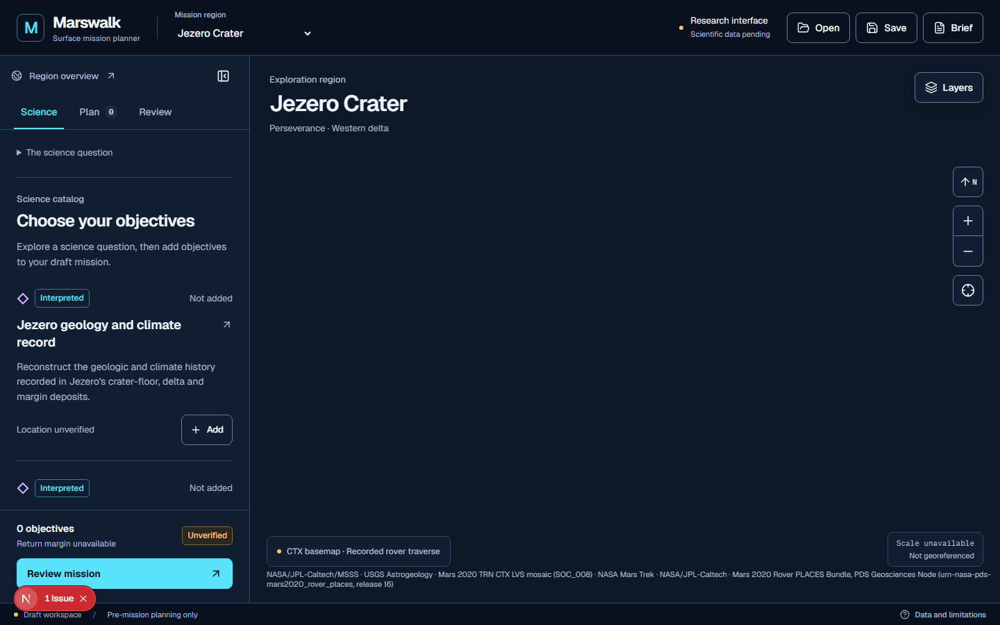
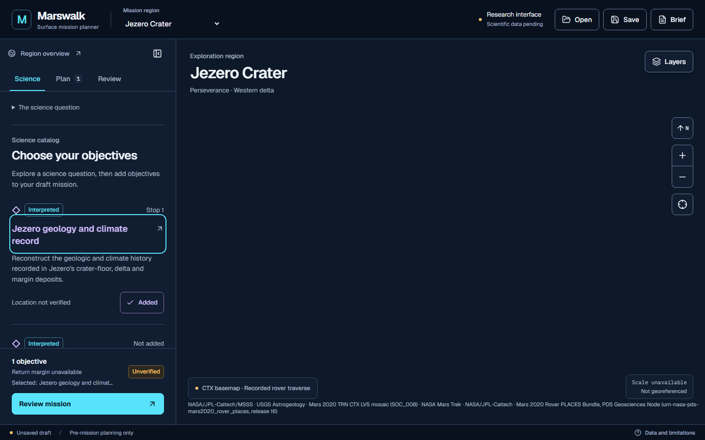
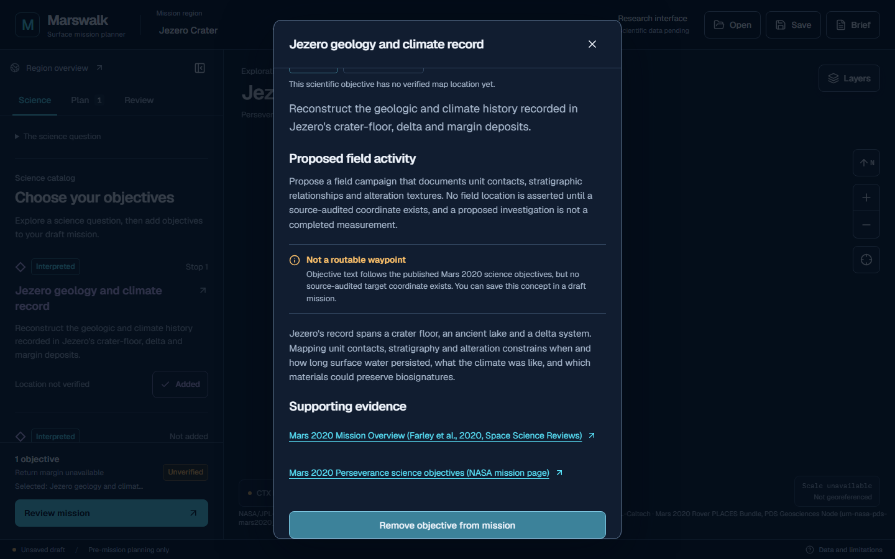

# Jezero JZ-T1A target marker correction

Status: implementation and validation complete; JZ-T1B/JZ-T2 not started. Date: 2026-11-14 (Asia/Rangoon).

## Repository and delivery

- Starting branch: verified `origin/feat/jezero-map`, commit `d9fbe2f2bf845ef76e69b61cfa0f874246630ca6`.
- Fetch: `git -c http.version=HTTP/1.1 fetch --no-tags --filter=blob:none origin feat/jezero-map`; independent `git ls-remote --heads origin feat/jezero-map` returned the same SHA.
- Branch: `feat/jezero-target-marker-correction`.
- Isolated worktree: `D:/martian-map/output/gale-g1/output/jezero-target-marker-correction`.
- Implementation commit: **0cbc88c7b34aabb447f8f236a18189f5a863cb35** (`fix(jezero): prevent unverified science target markers`). The following documentation commit records these results; the delivery HEAD is reported in the final response and resolves with `git rev-parse HEAD`. A committed file cannot contain its own final commit hash.
- JZ-T1 commit `9670ada94b634ab6a35b660c7e675ee9dfad4ac3` exists locally. Its report and manifest were read directly from the research worktree. No research files were merged or modified.
- All worktrees were inspected. Concurrent uncommitted renderer changes exist in `D:/martian-map` and the Gale coverage worktree; timeline-dashboard edits also exist. They were not imported, overwritten or reset. The marker-effect hunk will need normal integration review against those renderer changes. No merge was attempted.

## Defect and reproduced baseline

The old marker filter admitted unverified non-scenario objectives. Its coordinate expression attempted `[displayLon, displayLat]` as a fallback, although neither variable exists in the checked-out revision. Comments claimed a circular center distribution; the executable path instead raises `ReferenceError: displayLon is not defined`. The earlier JZ-T1 report described the intended fallback, not this runtime failure. This milestone corrects that finding: five visible center markers were **not** reproduced on this exact baseline.

The baseline was temporarily loaded from HEAD only inside this new worktree, then restored in a finally block. An exploratory assertion expecting five markers failed (actual zero); the browser console exposed the ReferenceError above. Its failure screenshot is retained as `before.png`. This is evidence of the actual baseline exception, not a fabricated successful marker capture. The corrected implementation has no center-coordinate fallback and passes an assertion of zero browser page exceptions.

## Files modified

- `lib/map/target-location.ts`: shared fail-closed geographic eligibility predicate and TypeScript coordinate narrowing.
- `components/map/map-workspace.tsx`: filters geographic markers through that predicate; removes fallback coordinates, unused local and unverified-marker styling. Marker clicks/highlights, dimensions, cleanup and camera effects are preserved.
- `components/science/catalog.tsx`: catalog and inspector use the same eligibility decision for location wording and coordinate display. Compact label: **Location not verified**. Explanation: **This scientific objective has no verified map location yet.**
- `lib/mission/model.ts`: routing preflight now requires the geographic predicate as well as existing routing eligibility.
- `tests/target-location.test.ts`: seventeen new unit regressions.
- `tests/browser/target-markers.spec.ts`: focused browser regression.
- `docs/diagnostics/jz-t1a/{before,after,inspector}.png`: browser evidence.
- This report.

No target records, descriptions, saved-mission schema, source rasters or geographic bounds changed. Current Jezero bounds remain 77.186786–77.493133 E, 18.401964–18.519663 N. No research regions or new point targets are displayed.

## Geographic rendering rules

A target must belong to the active region, have `coordinate_verified === true`, `verification === "verified"`, and pass the existing target schema. That schema requires Mars planetocentric latitude, east longitude in [0,360), latitude in [-90,90], supporting source IDs, and non-scenario/non-unavailable evidence. Explicit finite-number checks add a runtime guard. Its point must fall within the active supported extent, inclusively; missing coverage fails closed. Wrapped longitude extents are supported. There is no existing explicit out-of-coverage target feature on this base branch.

The existing interface-preview mode retains clearly labeled schematic scenario positions; these are not geographic scientific markers. Preview markers are additionally region-filtered. Jezero's interpreted objectives do not qualify for either scientific markers or scenario-preview markers. No camera, imagery or layer-control behavior was changed.

## Objectives, catalog and mission compatibility

All five Jezero science objectives retain their IDs and descriptions and remain inspectable and addable to a draft. No new type or schema migration was needed: existing verification, coordinate and routing fields already distinguish nonlocalized objectives from spatial targets. An objective selection is not a geographic waypoint.

There was no target-specific focus/zoom control in the base UI; none was added. Inspector selection never invokes a camera operation. Generic map zoom/reset controls remain available and do not imply a target location. No coordinate row is shown for an ineligible target.

Mission target IDs, reserves, ordering, save/reopen and v1 import compatibility are preserved. No start/endpoint is synthesized from an objective. `missionIssues` rejects targets lacking the full geographic predicate or available routing eligibility, including inconsistent/missing verification states. Route geometry generation and mission calculation engines were not modified. No timeline, weather or resource-budget logic changed.

## Shared renderer and other regions

The geographic predicate is region-independent and retains verified in-coverage point behavior. This branch's actual Gale and Oxia catalogs contain scenario objectives with null coordinates, not certified points; tests therefore use explicitly synthetic verified fixtures for all three regions. Those fixtures demonstrate verified eligibility and cross-region rejection without claiming new real scientific targets. Existing regional browser checks exercise real catalog isolation and retained drafts. Existing marker cleanup on region switch remains intact.

## Automated validation

Executed in this isolated worktree:

| Command | Result |
|---|---|
| `npx.cmd tsx --test tests/*.test.ts` | 30 passed, 0 failed (13 existing + 17 new) |
| `npm.cmd run typecheck` | Passed |
| `npm.cmd run lint` | Passed |
| `npm.cmd run build` | Passed, Next.js 16.4.6 Turbopack; static routes generated |
| `$env:PLAYWRIGHT_BASE_URL='http://127.0.0.1:3021'; $env:PORT='3021'; npx.cmd playwright test tests/browser/target-markers.spec.ts` | 1 passed; zero page exceptions |
| Same environment, `npx.cmd playwright test tests/browser/planner.spec.ts --grep 'mission JSON round trip|ordered objectives|target dialogs|MapLibre preview|registry-driven'` | 8 passed |
| `git diff --check` | Passed |

Browser coverage includes four viewport sizes, saved v1 mission roundtrip, ordered objectives/save-reopen, dialog focus/selection isolation, and preview camera/layer controls. The focused test requires an initialized scientific canvas and enabled zoom control before asserting marker absence, then checks catalog inspection, no geographic-focus actions, mission selection, region switching and zero page exceptions. Unit tests also cover null/unverified/pending/missing verification, nonfinite/out-of-range coordinates, wrong convention, missing source lineage, wrong region, outside/missing footprint, wrapped longitude and mission gating.

Initial attempts and corrections are recorded rather than counted as passes: test fixture typings initially needed non-null known-region lookups; build prebuild initially failed because there was no worktree-local dependency directory. A junction allowed prebuild but Turbopack rejected external-root resolution. A local copy of already installed dependencies resolved that environment issue; no dependency manifest was changed. The first browser invocation had mismatched server port configuration; the next attempt clicked the Plan tab instead of Science. Correcting the selector and PNG fixture yielded a healthy map and a passing focused run. The separate exploratory baseline run failed as described above and is not part of the nine passing correction regressions.

## Browser evidence and limitations

The worktree is sparse and omits bulk map tiles. The focused browser test serves valid transparent PNG tiles and an empty traverse FeatureCollection through test-only network handlers; production sources are unchanged. These screenshots demonstrate marker/UI behavior, not imagery alignment, terrain coverage or scientific geographic certification. The existing browser suite was run without those focused-test handlers. The full browser suite and unrelated routing/import/accessibility scenarios were not rerun. No physical navigation safety is inferred.

## Recommended JZ-T1B next steps

Review and integrate this minimal correction against concurrent shared-renderer work. Continue independent image-registration checks, invalid-source-polygon review and observation-to-localization joins from JZ-T1. Keep unverified candidates nonselectable geographically until that evidence is reviewed. This milestone does not authorize geological polygons, new targets or JZ-T2.

## Push status

Implementation push attempted normally with HTTP/1.1 and low-speed timeout settings. Final transfer result is recorded below before documentation delivery; no force push or merge is permitted.

Implementation push succeeded: origin/feat/jezero-target-marker-correction was created normally at 0cbc88c7b34aabb447f8f236a18189f5a863cb35. This documentation-only follow-up is pushed separately; final delivery HEAD and remote equality are verified in the final response.
