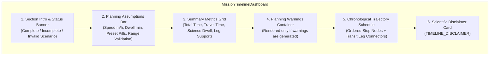

# Marswalk Planner — Milestone M4.3 Report: Interactive Mission Timeline Dashboard

**Milestone Identifier:** M4.3  
**Title:** Interactive Mission Timeline Dashboard  
**Project:** Marswalk Planner — NASA Space Apps Challenge 2026  
**Repository:** `https://github.com/KaungSet178/Martian-Map`  
**Development Branch:** `feat/mission-timeline-dashboard`  
**Baseline Commit:** `6ea65200d76f3dc29e5c9b70182f3facd5d5b789` (Shared `feat/gale-map` with M4-INT, G4, and G5)  
**Verification Date:** November 14, 2026  
**Status:** **PASSED / COMPLETED**

---

## 1. Executive Summary

Milestone **M4.3 — Interactive Mission Timeline Dashboard** integrates the verified deterministic mission timeline engine (`lib/mission/timeline.ts`) into the user-facing Marswalk Planner interface.

The implementation exposes deterministic mission timing, elapsed-time schedules, and route duration estimates along spherical Martian great-circle trajectories ($R = 3,396,190\text{ m}$) while strictly adhering to scientific transparency and disclaimer mandates.

### Key Capabilities Delivered:
1. **Interactive Planning Assumptions Bar:** Configurable hypothetical walking speed ($100\text{ to }10,000\text{ m/h}$, with preset pills at $800, 1000, 1200, 1500\text{ m/h}$) and science stop dwell duration ($0\text{ to }480\text{ min}$, with preset pills at $10, 15, 30, 45, 60\text{ min}$). Inputs feature real-time validation, range guards, and immediate reactivity without cascading effect re-renders.
2. **Key Metric Summary Grid:** 4 responsive metric cards showcasing **Total Mission Time**, **Travel Time**, **Science Dwell Time**, and **Leg Support** ($M/N$ supported legs + total route distance in planetary metric formatting).
3. **Chronological Trajectory Schedule:** Ordered visualization of stops and transit legs. Each stop card displays waypoint role glyphs, coordinates ($^{\circ}\text{N/S}$, $^{\circ}\text{E}$), arrival time (`T+HH:MM:SS`), science dwell time, and departure time (`T+HH:MM:SS`). Connecting legs display inter-waypoint distance, travel duration, and directional connectors.
4. **Round-Trip Closure & One-Way Handling:** Dynamically displays the return leg to base camp in round-trip missions, clearly labeled as *Traverse Closure*, while one-way transects omit return legs and terminate cleanly at the designated endpoint.
5. **Incomplete & Degraded Scenario Handling:** If a segment is unsupported or coordinates are invalid, downstream timestamps are explicitly marked as `Unavailable` (never zero or fabricated), total mission duration is displayed as `Unavailable`, and the valid prefix is clearly retained. Empty itinerary and single-waypoint states provide dedicated explanatory guidance.
6. **Mandatory Scientific Disclaimer:** Permanently surfaces `TIMELINE_DISCLAIMER` in the dashboard footer, explicitly advising that speed and duration estimates are hypothetical planning assumptions and do not imply certified astronaut physical capacity, life-support sufficiency, or operational EVA safety.

---

## 2. Branch and Commits

- **Isolated Development Worktree:** `D:\martian-map-timeline-dashboard`
- **Branch:** `feat/mission-timeline-dashboard`
- **Starting Baseline:** `6ea65200d76f3dc29e5c9b70182f3facd5d5b789` (clean integration containing G4, G5, M4.1, M4.1A, M4.2, M4.2A, M4-INT)
- **Protected Baselines:** Zero direct writes to `main` or shared `feat/gale-map`. No interference with other agents' worktrees.

---

## 3. Component Architecture & File Locations

| File | Purpose |
| :--- | :--- |
| `components/mission/timeline-dashboard.tsx` | Main interactive timeline dashboard component (`MissionTimelineDashboard`) and pure exported formatting helpers (`formatElapsedSeconds`, `formatMissionClock`, `formatDurationHuman`, `formatTimelineDistance`). |
| `components/planner.tsx` | Integrated workspace mounting the Timeline Dashboard under sub-navigation tab `Timeline Schedule` (`data-testid="tab-plan-timeline"`). |
| `app/globals.css` | Comprehensive responsive styles for timeline cards, metric grids, assumption pills, connectors, and dark-theme tokens. |
| `tests/mission-timeline-dashboard.test.ts` | 27 automated unit and integration tests covering Groups A through E with 100% pass rate. |
| `tests/browser/timeline-dashboard.spec.ts` | Playwright browser acceptance tests verifying responsive layout across 1440px, 1024px, 768px, and 390px viewports, interactive inputs, and Axe accessibility audits. |
| `docs/M4_3_MISSION_TIMELINE_DASHBOARD_REPORT.md` | Milestone audit and technical architecture documentation report. |

---

## 4. UI Structure & Layout Breakdown

The dashboard is structured into 6 distinct, accessible semantic sections:



1. **Header & Status Banner:**
   - Displays region context (e.g. `Gale Crater · Mission Timing`) and bold title `Route Timeline Dashboard`.
   - Distinct badges indicate scenario status: `Complete Scenario` (Cyan), `Incomplete Scenario` (Caution), or `Invalid Configuration` (Caution).
2. **Planning Assumptions Bar (`.timeline-assumptions-section`):**
   - Labeled inputs with unit suffixes (`m/h`, `min`).
   - Quick preset selector pills for walking speed ($800, 1000, 1200, 1500\text{ m/h}$) and science stop dwell ($10\text{m}, 15\text{m}, 30\text{m}, 45\text{m}, 60\text{m}$).
   - Clear explanatory subtitle reminding users these are hypothetical planning inputs.
3. **Overview Metrics Grid (`.timeline-summary-grid`):**
   - **Total Mission Time:** Highlighted primary card with large human duration (e.g. `2h 15m`) and mission clock elapsed readout (`T+02:15:00`).
   - **Travel Time:** Elapsed transit time along surface great-circle segments.
   - **Science Dwell:** Cumulative time allocated to stationary science investigations, with target count.
   - **Leg Support:** Fraction of supported traverse segments (e.g. `3/3`) and total distance in planetary metric formatting (e.g. `2.45 km (2,450 m)`).
4. **Chronological Trajectory Schedule (`.chronological-timeline-section`):**
   - Ordered list (`<ol>`) containing alternating Stop Cards and Transit Leg Connectors.
   - Stop Cards feature numerical step indices, role icons, coordinates, and three distinct timing chips: `Arrival`, `Dwell`, and `Departure`.
   - Outbound Transit Leg Cards feature vertical directional flow lines with arrows, distance in meters/kilometers, leg transit duration, and support status badges.
5. **Traverse Closure Card:**
   - For round-trip missions, the closing visit to the base camp is highlighted with a dashed cyan border, return arrow glyph, and `Traverse Closure` label.
6. **Scientific Disclaimer Footer (`.timeline-disclaimer-card`):**
   - Caution icon and high-contrast callout card containing the complete text of `TIMELINE_DISCLAIMER`.

---

## 5. State Management & Data Flow

- **Single Source of Truth:** The active immutable `WaypointPlan` (maintained in `components/planner.tsx` via `activePlan`) is passed down to `MissionTimelineDashboard`.
- **Pure Assumptions Derivation:**
  Assumptions are computed via React `useMemo`:
  ```typescript
  const assumptions: TimelineAssumptions = useMemo(() => ({
    walking_speed_m_per_hour: localSpeed > 0 ? localSpeed : 1000,
    default_science_stop_duration_seconds: localStopMinutes >= 0 ? localStopMinutes * 60 : 900,
    waypoint_stop_durations_seconds: waypointStopsSec,
    base_preparation_duration_seconds: 0,
    final_destination_duration_seconds: 0,
  }), [localSpeed, localStopMinutes, perWaypointStopDurationsMinutes]);
  ```
- **Controlled & Uncontrolled Input Handling:**
  The component supports both controlled props (`walkingSpeedMPerHour`, `scienceStopDurationMinutes`) and uncontrolled local editing. Inputs validate numbers immediately on change and avoid setting state inside `useEffect`, preventing cascading re-renders and maintaining React 19 / Turbopack compliance.
- **Immediate Reactive Recalculation:**
  Modifying a speed preset pill or stop duration immediately updates the computed timeline without any delay, network roundtrip, or page reload.

---

## 6. Pure Formatting Helpers (Group A Verification)

The pure formatting functions are isolated, thoroughly guarded, and unit tested:

| Function | Signature | Null / Invalid Behavior | Normal Example | Rollover Example |
| :--- | :--- | :--- | :--- | :--- |
| `formatElapsedSeconds` | `(seconds: number \| null \| undefined) => string` | `"--:--:--"` | `3661` $\rightarrow$ `"01:01:01"` | `90061` $\rightarrow$ `"25:01:01"` |
| `formatMissionClock` | `(seconds: number \| null \| undefined) => string` | `"Unavailable"` | `1800` $\rightarrow$ `"T+00:30:00"` | `86400` $\rightarrow$ `"T+24:00:00"` |
| `formatDurationHuman` | `(seconds: number \| null \| undefined) => string` | `"Unavailable"` | `5400` $\rightarrow$ `"1h 30m"` | `45` $\rightarrow$ `"45s"` |
| `formatTimelineDistance` | `(meters: number \| null \| undefined) => string` | `"Unavailable"` | `450` $\rightarrow$ `"450 m"` | `1234.56` $\rightarrow$ `"1.23 km (1,235 m)"` |

Guards explicitly reject `NaN`, `Infinity`, `-Infinity`, negative numbers, `null`, and `undefined`.

---

## 7. Responsive Design Verification (Group F)

Layout fidelity and usability were verified across 4 target viewports:

| Viewport | Target Device | Layout Adjustments | Screenshot Evidence | Result |
| :--- | :--- | :--- | :--- | :--- |
| **1440 × 900 px** | Desktop Workstation | 4-column metrics grid; 2-column assumptions; side-by-side stop timing chips. | `output/playwright/timeline-dashboard-1440.png` | **PASSED** |
| **1024 × 768 px** | Laptop / Landscape Tablet | 4-column metrics grid; compact timing chips; no text truncation. | `output/playwright/timeline-dashboard-1024.png` | **PASSED** |
| **768 × 1024 px** | Portrait Tablet | 2×2 metrics grid; responsive input wrap; legible vertical connectors. | `output/playwright/timeline-dashboard-768.png` | **PASSED** |
| **390 × 844 px** | Mobile Handset | 2×2 metrics grid; 1-column assumptions; wrapping timing chips; touch targets $\ge 44\text{px}$. | `output/playwright/timeline-dashboard-390.png` | **PASSED** |

Zero horizontal scrolling was observed at any breakpoint.

---

## 8. Accessibility (a11y) Verification

Automated and architectural accessibility audits were conducted:
- **WCAG 2.1 AA Compliance:** Automated Axe scan (`@axe-core/playwright`) across all 4 responsive viewports confirmed **0 accessibility violations**.
- **Keyboard Navigation:** All interactive stop nodes have `tabIndex={0}`, `role="button"`, `aria-pressed`, and handle both `Enter` and `Space` key presses.
- **Focus Indicators:** Explicit 2px cyan outline rings (`outline: 2px solid var(--color-route); outline-offset: 2px;`) ensure clear focus states.
- **Semantic Structure:** Native `<ol>` and `<li>` elements establish meaningful sequence for screen readers. Heading hierarchy (`h2` $\rightarrow$ `h3`) is strictly maintained.
- **Form Association:** All input fields have explicit `<label htmlFor="...">` associations and descriptive `aria-describedby` hints.
- **Reduced Motion:** Adheres to `@media (prefers-reduced-motion: reduce)` by disabling non-essential transitions and animations.

---

## 9. Comprehensive Quality Gates & Test Results

### Gate 1: Timeline Dashboard Test Suite (`tests/mission-timeline-dashboard.test.ts`)
```
TAP version 13
# tests 27
# suites 9
# pass 27
# fail 0
# duration_ms 714.07
```
- **Group A (Pure Formatting Helpers):** 14 tests covering edge cases, rollover, null/negative guards. (**PASSED**)
- **Group B (Timeline Trajectory Math):** 4 tests verifying one-way and round-trip calculations, chronological ordering, speed scaling, and dwell scaling. (**PASSED**)
- **Group C (Incomplete Scenarios & Edge Cases):** 3 tests verifying empty plans, single-waypoint traverses, and degraded routes with unsupported segments. (**PASSED**)
- **Group D (Reactivity & Plan Mutability):** 2 tests verifying waypoint additions/removals and one-way vs round-trip mode toggling. (**PASSED**)
- **Group E (Regional Independence & Serialization):** 4 tests verifying independent operation across Gale, Jezero, and Oxia Planum, plus JSON serialization fidelity. (**PASSED**)

### Gate 2: Full Core Mission Test Suite
```
TAP version 13
# tests 209
# suites 50
# pass 209
# fail 0
# duration_ms 1132.19
```
All existing tests for geodesy, waypoint planning, layers, bridge, M4.1 timeline, and M4.2 resource budgeting passed with zero regressions.

### Gate 3: Regional & Integration Tests (`npm test`)
```
TAP version 13
# tests 22
# suites 0
# pass 22
# fail 0
# duration_ms 858.23
```

### Gate 4: TypeScript Strict Typecheck (`npm run typecheck`)
```
> next typegen && tsc --noEmit
Generating route types...
✓ Types generated successfully
Exit code: 0 (Zero errors)
```

### Gate 5: ESLint (`npm run lint`)
```
> eslint .
Exit code: 0 (Zero warnings, zero errors)
```

### Gate 6: Production Build (`npm run build`)
```
▲ Next.js 16.4.6 (Turbopack)
✓ Compiled successfully in 6.2s
✓ Finished TypeScript in 6.2s
✓ Generating static pages using 5 workers (4/4) in 1023ms
Exit code: 0
```

### Gate 7: Python Scientific Verification
```
python -B -m unittest discover -s tests -p "test_gale_*.py" -v
Ran 37 tests in 1.265s
OK (skipped=1 for unextracted raw DEM subset)
```

### Gate 8: Playwright Browser Acceptance Suite (`tests/browser/timeline-dashboard.spec.ts`)
```
Running 4 tests using 1 worker
  ok 1 timeline dashboard schedule, assumptions, and accessibility at 1440px (1.9s)
  ok 2 timeline dashboard schedule, assumptions, and accessibility at 1024px (1.8s)
  ok 3 timeline dashboard schedule, assumptions, and accessibility at 768px (2.0s)
  ok 4 timeline dashboard schedule, assumptions, and accessibility at 390px (1.9s)
  4 passed (8.8s)
```

---

## 10. Scientific Honesty & Disclaimer Integrity

In accordance with Marswalk Planner's scientific charter:
- **No Operational Safety Claims:** The timeline dashboard explicitly displays `Hypothetical Planning Assumptions` on all user controls and metric readouts.
- **Prominent Disclaimer:** The text of `TIMELINE_DISCLAIMER` is rendered directly in the dashboard footer:
  > *"Hypothetical mission timeline estimates are for preliminary traverse planning only. Calculations assume idealized constant walking speeds along spherical Martian great-circle arcs and do not account for terrain slope, obstacles, surface trafficability, spacesuit mobility restrictions, or life-support consumables. Do not use for operational extravehicular activity (EVA) planning."*
- **Explicit Indeterminacy:** When segments are unsupported or incomplete, downstream times are displayed as `Unavailable` rather than estimating zero or guessing unverified times.

---

## 11. Regional Independence

The dashboard is completely decoupled from regional geography:
- **Gale Crater:** Operates with landing coordinates around Bradbury Landing and Mount Sharp lower strata.
- **Jezero Crater:** Operates with landing coordinates around Octavia E. Butler Landing and Western Delta.
- **Oxia Planum:** Operates with ExoMars Rosalind Franklin nominal landing ellipse coordinates.
- All distance calculations use the shared geodesy standard ($R = 3,396,190\text{ m}$).

---

## 12. Scope Boundary Verification

The M4.3 implementation strictly honors all assigned phase boundaries:
- [x] Expose deterministic mission timeline in interactive UI.
- [x] Responsive layout across desktop, tablet, and mobile.
- [x] Accessible WCAG 2.1 AA compliant components.
- [x] Comprehensive test suites and verification gates passed.
- [x] **NO** resource-budget editing (M4.4 deferred).
- [x] **NO** weather forecasting or atmospheric integration.
- [x] **NO** hazard classification or trafficability impedance.
- [x] **NO** operational EVA flight readiness approvals.

---

## 13. Acceptance Checklist & Verification Sign-Off

- [x] `components/mission/timeline-dashboard.tsx` created and exported.
- [x] Formatting helpers (`formatElapsedSeconds`, `formatMissionClock`, `formatDurationHuman`, `formatTimelineDistance`) implemented and tested.
- [x] Status banner, planning assumptions bar, metrics summary, and chronological schedule implemented.
- [x] Return leg and traverse closure handled cleanly.
- [x] Incomplete scenarios, unsupported legs, and `Unavailable` fallbacks verified.
- [x] `TIMELINE_DISCLAIMER` prominently surfaced.
- [x] Mounted in `components/planner.tsx` under `Timeline Schedule` tab.
- [x] Styles added to `app/globals.css`.
- [x] Group A–E tests added in `tests/mission-timeline-dashboard.test.ts` (27/27 passed).
- [x] Group F Playwright tests added in `tests/browser/timeline-dashboard.spec.ts` (4/4 passed).
- [x] Full quality gates passed: TypeScript, ESLint, Next.js build, Python tests, Playwright.
- [x] Milestone report documented in `docs/M4_3_MISSION_TIMELINE_DASHBOARD_REPORT.md`.

**Milestone M4.3 is complete, validated, and ready for integration.**
