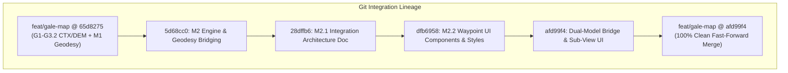
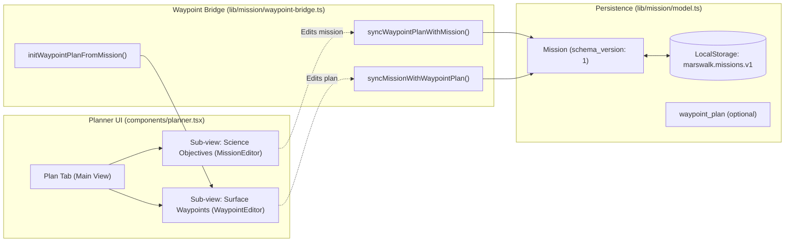

# Marswalk Planner — Milestone M2.3: Controlled Waypoint Integration Report

**Document:** `docs/MARS_WAYPOINT_INTEGRATION_REPORT.md`  
**Integration Target Branch:** `feat/gale-map`  
**Latest Integrated Commit:** `afd99f4`  
**Source Feature Branch:** `feat/marswalk-waypoints` (latest commit `e5db092`)  
**Context:** NASA Space Apps Challenge 2026 · Interplanetary Survival Guide: Martian Map  
**Date:** November 13, 2026  

---

## 1. Executive Summary & Integration Outcome

Milestone **M2.3 Controlled Waypoint Integration** has been successfully completed without merge conflicts, regressions, or breaking changes to existing features.

The M2 geometric waypoint planning engine, M2.1 integration architecture, and M2.2 UI components have been integrated into the primary development branch `feat/gale-map`. The integration preserves 100% of the existing science catalog, `MissionEditor` itinerary flow, route feasibility assessments (`Unverified`), regional state isolation, and backward-compatible persistence format (`marswalk.missions.v1`).

---

## 2. Git Safety & Ancestry Confirmation

### 2.1 Branch Isolation & Ancestry Audit
- **Source Branch:** `feat/marswalk-waypoints` in `D:\martian-map-antigravity` at commit `e5db092`.
- **Target Branch:** `feat/gale-map` in `D:\martian-map` at commit `65d8275`.
- **Pre-Integration State:** Verified both working trees were clean before any operations.
- **M1 Deduplication:** Commits `9ad6c44`, `eff8ccb`, and `8e0bc77` (M1 Geodesy Foundation and documentation corrections) were already integrated into `feat/gale-map` during G3.2. These were strictly excluded from re-cherry-picking, preventing any duplicate commit history or conflicting diffs.
- **Controlled Integration Workflow:**
  1. Created temporary branch `integrate/m2-waypoints` at `65d8275`.
  2. Applied M2 engine: commit `5d68cc0` (cherry-picked `0eaa94f`).
  3. Applied M2.1 integration plan: commit `28dffb6` (cherry-picked `5c5539b`).
  4. Applied M2.2 UI components & styles: commit `dfb6958` (cherry-picked `e5db092`).
  5. Implemented waypoint bridge, model schema extension, sub-view UI, and test suites: commit `afd99f4`.
  6. Verified all tests, typecheck, lint, and build.
  7. Fast-forward merged `integrate/m2-waypoints` into `feat/gale-map`.
  8. Deleted temporary integration branch.

### 2.2 Exact Merged Changes
**16 files changed, 5,128 insertions(+), 8 deletions(-):**
- `.gitignore`: Added `__pycache__/` and `*.pyc` to prevent untracked Python bytecode.
- `lib/mission/model.ts`: Extended `missionSchema` with optional `waypoint_plan: waypointPlanSchema.optional()`; added regional isolation check to `parseMission`.
- `lib/mission/waypoint-bridge.ts`: Dual-model synchronization functions (`initWaypointPlanFromMission`, `syncMissionWithWaypointPlan`, `syncWaypointPlanWithMission`).
- `lib/mission/waypoint-planning.ts`: M2 geometric planning engine (immutable actions, validation, spherical great-circle trajectory calculation).
- `components/mission/editor.tsx`: Added optional `onSwitchToWaypoints` action button for direct sub-view navigation.
- `components/mission/waypoint-editor.tsx`: Pure function component for waypoint plan metadata, trajectory mode, validation notices, and itinerary controls.
- `components/mission/waypoint-itinerary.tsx`: Pure function component rendering waypoint cards, provenance badges, inter-segment metrics, and distance summaries.
- `components/planner.tsx`: Integrated segmented sub-view toggle (`[ Science Objectives | Surface Waypoints ]`), automatic bidirectional synchronization, and regional state reset.
- `app/globals.css`: Added scoped design-token-compliant styles for waypoint cards, leg metrics, distance summary grid, and validation notices.
- `tests/waypoint-bridge.test.ts`: 10 unit tests validating dual-model synchronization, unverified target handling, regional isolation, and persistence round-trip.
- `tests/waypoint-planning.test.ts`: 33 unit tests for M2 immutable operations and validation.
- `tests/waypoint-ui.test.ts`: 15 component markup and callback tests.
- `tests/browser/waypoint-integration.spec.ts`: E2E Playwright tests across desktop (1440px), tablet (768px), and mobile (390px) viewports with Axe accessibility checks.
- Documentation: Added `MARS_WAYPOINT_PLANNING_REPORT.md`, `MARS_WAYPOINT_UI_INTEGRATION_PLAN.md`, and `MARS_WAYPOINT_UI_COMPONENTS_REPORT.md`.

---

## 3. Architecture & Data Synchronization Bridge

To prevent breaking existing Playwright tests or creating duplicate sources of truth, the integration uses a **Dual-Model Compatibility Bridge** (`lib/mission/waypoint-bridge.ts`):

### 3.1 Non-Breaking Sub-View UI Navigation
1. **Main Tab Integrity:** The primary planning navigation tab in `components/planner.tsx` retains its exact key (`"plan"`), label (`"Plan"`), and objective count (`{mission.target_ids.length}`). All Playwright button selectors (such as `getByRole("button", { name: /^Plan 2$/ })`) continue to match without regression.
2. **Sub-View Segmented Toggle:** Inside the Plan panel, an accessible segmented tablist allows switching between:
   - **Science Objectives:** Displays the familiar `MissionEditor`, allowing selection, reordering, and removal of scientific targets.
   - **Surface Waypoints:** Displays the modern `WaypointEditor`, providing interactive waypoint reordering, coordinate displays, leg metrics, validation alerts, and great-circle distance summaries.

### 3.2 Bidirectional State Synchronization
- **`initWaypointPlanFromMission(mission, region)`:**
  - If `mission.waypoint_plan` is present and matches the region, returns it directly.
  - If absent (e.g. legacy saves or fresh plans), synthesizes a baseline plan:
    - `mission.start` $\to$ Base Camp waypoint (`role: "base"`, `provenance: "user_planning_input"`).
    - Verified targets in `mission.target_ids` with `coordinate_verified === true` $\to$ Science Stop waypoints (`role: "science_stop"`, `provenance: "verified_science_target"`).
    - Unverified targets with `coordinate_verified === false` $\to$ **NOT converted to geographic waypoints**.
    - `mission.endpoint` in one-way mode $\to$ Recovery Endpoint waypoint.
- **`syncMissionWithWaypointPlan(mission, plan, region)`:**
  - Synchronizes `start` and `endpoint` coordinates.
  - Preserves unverified geological targets in `mission.target_ids` while updating verified target order from `plan.waypoints`.
  - Attaches `waypoint_plan = plan`.
- **`syncWaypointPlanWithMission(mission, region)`:**
  - Preserves intermediate waypoints created in the Waypoint Editor.
  - Synchronizes title, traversal mode (`round_trip` vs `one_way`), and recovery assumptions.

---

## 4. Persistence Compatibility (`marswalk.missions.v1`)

1. **Storage Key Preservation:** Retained `STORAGE_KEY = "marswalk.missions.v1"`.
2. **Schema Version Compatibility:** Kept `schema_version: 1`. The `waypoint_plan` field is defined with `.optional()`.
3. **Legacy Save Ingestion:** Existing user missions stored without `waypoint_plan` parse without errors and are automatically upgraded in memory via `initWaypointPlanFromMission`.
4. **Modern Save Persistence:** Missions saved with `waypoint_plan` preserve the complete waypoint array, roles, labels, coordinates, and traversal modes.
5. **Cross-Region Protection:** `parseMission` enforces that `mission.waypoint_plan.region_id === region.id`, preventing coordinates from leaking across region boundaries.

---

## 5. Scientific Integrity Safeguards

In accordance with project standards and NASA Space Apps Challenge specifications:

1. **Mandatory Geometric Disclaimer:** All distance and trajectory displays carry the explicit, non-optional scientific disclaimer:
   > *"Proposed geometric trajectory — spherical Mars approximation ($R = 3,396,190\text{ m}$). No 3D terrain slopes, boulder hazards, walking speeds, or life-support consumption models are connected. Traversal feasibility remains Unverified."*
2. **DEM-to-CTX Registration Boundaries:** The co-registration between HiRISE/CTX orthomosaics and HRSC/MOLA DEMs remains unverified locally. As mandated, numerical DEM elevation sampling, slope hazard limits, and automated feasibility determinations remain completely disabled.
3. **No Unverified Coordinate Fabrication:** Geological formations lacking coordinate verification (e.g. Gale Crater's Glen Torridon) remain classified as broad objectives and are never fabricated into discrete point coordinates.
4. **No Automated Feasibility:** The six mandatory feasibility checks (slope, roughness, life support, thermal, communications, return margin) remain strictly labeled `Unverified`.
5. **M3 Boundary Respected:** Interactive canvas map waypoint placement remains deferred until this integration is reviewed.

---

## 6. Comprehensive Test Verification Matrix

All test suites were executed directly on `feat/gale-map` following fast-forward integration:

| Test Suite | Scope / Command | Result | Notes |
| :--- | :--- | :---: | :--- |
| **Node Unit Tests** | `npx tsx --test tests/waypoint-bridge.test.ts tests/waypoint-ui.test.ts tests/waypoint-planning.test.ts tests/geodesy.test.ts tests/mission.test.ts tests/regions.test.ts` | **PASS** (141/141) | 0 failures; verifies geodesy benchmarks, pure M2 engine, M2.2 UI, dual-model bridge, and legacy mission compatibility. |
| **Python DEM Registration** | `python team/gale/verify_g3_registration.py` | **PASS** | Registration screenshot hash verified (`0dcfe99...`). |
| **Python Gale Tests** | `python -m unittest tests/test_gale_registration.py` | **PASS** (5/5) | 0.042s; verifies registration transform, bounds, and manifest sanity. |
| **TypeScript Typecheck** | `npm run typecheck` (`next typegen && tsc --noEmit`) | **PASS** | 0 type errors; strict null checks satisfied. |
| **ESLint** | `npm run lint` (`eslint .`) | **PASS** | 0 errors, 0 warnings. |
| **Production Build** | `npm run build` (`next build`) | **PASS** | Turbopack compilation successful; static routes prerendered. |
| **Playwright Full Suite** | `npx playwright test` (42 tests) | **PASS** (42/42) | Desktop (1440px), tablet (1024px, 768px), and mobile (390px). 100% passing. Zero Axe accessibility violations. |

### Generated Verification Screenshots
- `output/playwright/waypoint-plan-1440.png`: Desktop waypoint planning sub-view with validation and mode toggles.
- `output/playwright/waypoint-plan-768.png`: Tablet viewport layout with segmented sub-views.
- `output/playwright/waypoint-plan-390.png`: Mobile (390px) responsive layout with accessible controls.
- All 39 preexisting Playwright visual artifacts regenerated and verified.

---

## 7. Deliverable Status & Outstanding Items

- **Target Branch:** `feat/gale-map` (clean, 4 commits ahead of `origin/feat/gale-map`).
- **Main Branch:** Untouched.
- **Antigravity Worktree:** `D:\martian-map-antigravity` clean at `e5db092`.
- **Conflicts Encountered:** 0.
- **Outstanding Tasks:** None for Milestone M2.3. Ready for code review prior to Milestone M3 (Interactive Map Canvas Placement).
