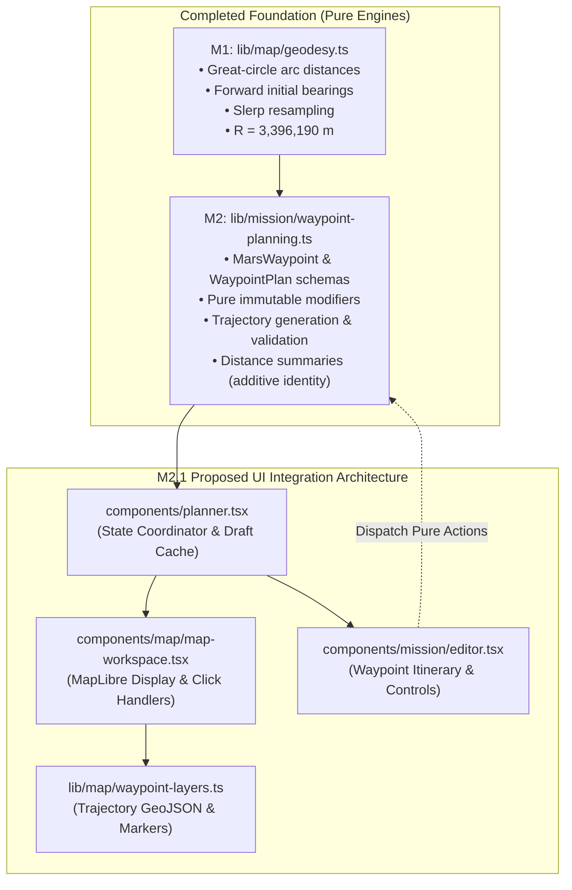
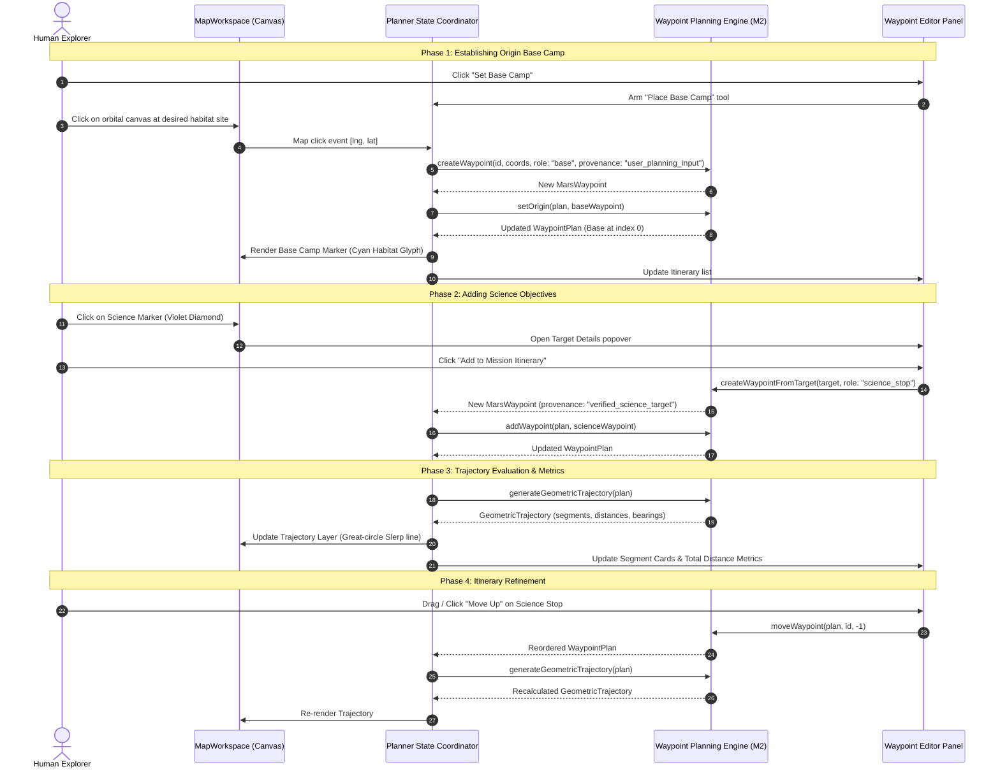
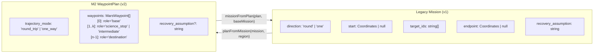
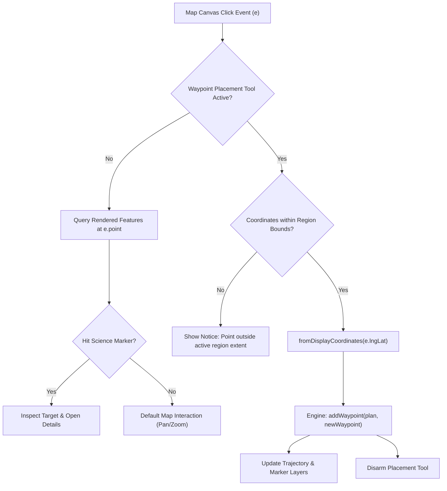
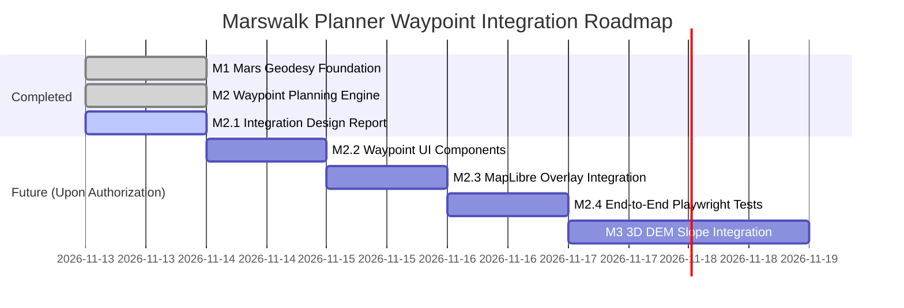

# Marswalk Planner — Milestone M2.1: Interactive Mission Planning Integration Design

**Document:** `docs/MARS_WAYPOINT_UI_INTEGRATION_PLAN.md`  
**Status:** Design & Architectural Specification (Non-executable review document)  
**Target Branch:** `feat/marswalk-waypoints` in `D:\martian-map-antigravity`  
**Foundation Modules:** `lib/map/geodesy.ts` (M1 Geodesy) & `lib/mission/waypoint-planning.ts` (M2 Engine)  
**Context:** NASA Space Apps Challenge 2026 · Interplanetary Survival Guide: Martian Map  

---

## 1. Executive Summary & Design Scope

The objective of Milestone M2.1 is to deliver an exhaustive, scientifically rigorous, and implementation-ready architectural design for integrating the **M2 Geometric Waypoint Planning Foundation** into the interactive **Marswalk Planner** user interface.

### Strict Non-Modification Boundary (M2.1 Mandate)
- **Zero Production Code Changes:** In accordance with the M2.1 directive, no application code, shared MapLibre components, existing mission UI, regional manifests, or DEM processing code is modified in this milestone.
- **Git & Worktree Isolation:** Work remains exclusively within `D:\martian-map-antigravity` on `feat/marswalk-waypoints`. The Codex workspace (`D:\martian-map`) and branch (`feat/gale-map`) are completely untouched.
- **Scientific Safeguards:** The interface design enforces absolute clarity between hypothetical user inputs, verified NASA observation locations, broad geological formations, spherical geometric baselines, and terrain-validated traversals.



---

## 2. Current UI Architecture & Relevant Files

The existing application is structured as a Next.js App Router client-side mission workstation. The key files involved in this integration are:

| File Path | Current Role | Integration Responsibility |
| :--- | :--- | :--- |
| `app/page.tsx` | Root entry point rendering `Planner`. | Unchanged. |
| `components/planner.tsx` | Main application shell; manages regional switching, mission drafts, active panel (`science`, `plan`, `compare`, `layers`, `evidence`), modals, and offline detection. | Hosts `WaypointPlan` state; bridges legacy `Mission` with `WaypointPlan`; controls interactive "Add Waypoint" tool state. |
| `components/map/map-workspace.tsx` | MapLibre GL wrapper; manages viewport resizing, raster tiles, GeoJSON overlays, science stop markers, and camera overview. | Adds interactive canvas click handling for waypoint placement; mounts trajectory GeoJSON sources and waypoint marker layers. |
| `components/mission/editor.tsx` | Form for mission name, direction (`round`/`one`), ordered target IDs, and scenario resource preferences. | Transformed into an interactive Waypoint Itinerary editor: custom base camps, science stops, intermediate turns, destination, reordering, and distance metrics. |
| `components/science/catalog.tsx` | Displays regional target catalog, filterable by priority and verification. | Provides "Add to Plan as Science Stop" action for coordinate-verified point targets; displays disabled state with informative tooltip for broad geological areas. |
| `components/mission/analysis.tsx` | Route comparison and readiness review; displays feasibility status (`Unverified`). | Consumes geometric trajectory metrics; displays explicit distinction between geometric baseline and unavailable terrain-evaluated routes. |
| `components/mission/brief.tsx` | Formats and prints/exports mission briefing HTML. | Incorporates waypoint coordinate tables, provenance badges, segment distance breakdowns, and scientific disclaimers. |
| `lib/mission/model.ts` | Legacy `Mission` schema v1 and localStorage persistence (`marswalk.missions.v1`). | Extended/adapted via migration layer to support `WaypointPlan` without breaking backward compatibility. |
| `lib/mission/waypoint-planning.ts` | M2 pure planning engine: immutable operations, schema validation, trajectory generation. | Consumed directly by React components for all plan mutations and trajectory evaluations. |
| `lib/map/region-layers.ts` | Display coordinate projection (`toDisplayCoordinates`), raster and GeoJSON mounting. | Provides inverse coordinate projection (`fromDisplayCoordinates`) for map click events. |

---

## 3. Proposed Interactive Waypoint Workflow

The user experience centers around an intuitive, map-driven loop where the explorer alternates between spatial inspection on the orbital canvas and itinerary structuring in the planning drawer.



### Detailed Interaction Steps

1. **Canvas Mode Selection & Tool Arming:**
   - In the top-right toolbar of the map or within the Waypoint Editor header, an "Add Waypoint" action button toggles the active placement tool.
   - When armed:
     - The map cursor changes to a precision crosshair (`cursor: crosshair`).
     - A floating non-obstructive toast appears at the top of the map: *"Click anywhere on the map to place an intermediate waypoint, or click a science target."*
     - Normal drag-panning and pinch-zooming remain operational.

2. **Placing a User-Defined Planning Waypoint:**
   - Clicking on an unoccupied surface location calculates the Mars East planetocentric coordinates using `fromDisplayCoordinates(e.lngLat)`.
   - Generates a `MarsWaypoint` with:
     - `role: "intermediate"`
     - `provenance: "user_planning_input"`
     - `label: "Waypoint N"` (editable inline)
   - Appends the waypoint to the itinerary via pure `addWaypoint(plan, waypoint)`.

3. **Selecting Verified Science Stops:**
   - **From Map:** Clicking directly on an existing science marker (violet diamond) inspects the target and offers an "Add as Science Stop" button.
   - **From Catalog:** In the Science tab, each coordinate-verified target displays an "Add to Plan" button.
   - Both pathways invoke `createWaypointFromTarget(target)` which locks:
     - `role: "science_stop"`
     - `target_id: target.id`
     - `provenance: "verified_science_target"`
     - `label: target.title`
   - **Disallowed Area Targets:** Targets with `feature_kind === "geological_area"` or `coordinate_verified === false` display a disabled button with an alert: *"Geological areas cannot be represented as discrete point waypoints."*

4. **Reordering and Removing Waypoints:**
   - Waypoint cards in the itinerary panel display:
     - Step sequence number (`1, 2, 3...`)
     - Role icon (Base, Science Stop, Intermediate, Destination)
     - Label and coordinates in monospace (`IBM Plex Mono`)
     - Segment distance and initial bearing to next stop
   - Interactive reordering via:
     - Keyboard-accessible "Move Up" ($\uparrow$) and "Move Down" ($\downarrow$) icon buttons.
     - Direct drag-and-drop handle (using accessible HTML5 drag-and-drop or pointer events).
     - Direct removal via "Delete" ($X$) button, invoking pure `removeWaypoint(plan, id)`.

5. **Origin & Destination Designation:**
   - **Origin:** The first waypoint is designated as `base`. Users can click "Set as Origin" on any existing waypoint to promote it to index 0 using `setOrigin(plan, waypoint)`.
   - **Destination (One-Way Mode):** Toggling direction to "One Way" designates the final waypoint as `destination` (or `recovery_endpoint`). The UI reveals a required textarea for `recovery_assumption`.

6. **Viewing Geometric Trajectory & Segment Metrics:**
   - Trajectory segments are rendered dynamically as solid cyan lines (`#59E3FA`) with dark casings (`#09111F`) on the MapLibre canvas.
   - For round-trip missions, the closing return leg from $W_{n-1}$ back to $W_0$ is visually distinguished with a dashed cyan styling (`dasharray: [2, 2]`) and labeled *"Return to Base Camp"*.
   - Each leg in the itinerary list displays:
     - Surface Distance (e.g. `1,420 m` or `2.85 km`)
     - Forward Azimuth (e.g. `042°`)
   - The summary footer displays:
     - Outbound Distance: `Σ outbound`
     - Return Closure Distance: `s(W_n-1, W_0)`
     - Total Surface Distance: `Σ total`
     - Prominent disclaimer: *"Proposed geometric trajectory — spherical Mars approximation (R = 3,396,190 m)"*.

7. **Resetting to Overview:**
   - The "Reset View" / "Fit Region" button (`Crosshair` icon) resets the camera smoothly to the regional bounds.
   - Selecting a specific waypoint in the list smoothly pans the camera to center on that waypoint without altering zoom level.

---

## 4. Component Responsibilities & Tree Hierarchy

The proposed component architecture strictly modularizes UI concerns and keeps state management pure:

```
components/planner.tsx (Root Workspace Container)
├── header.app-header (Brand, Region Switcher, Storage Actions)
├── main.workspace
│   ├── aside.task-panel (Collapsible Drawer / Sheet)
│   │   ├── nav.panel-tabs (Science | Plan | Review | Layers)
│   │   └── div.panel-scroll
│   │       ├── [panel === "science"] -> TargetCatalog
│   │       ├── [panel === "plan"] -> WaypointEditor (NEW / REFACTORED)
│   │       │   ├── WaypointPlanHeader (Name, Mode Selector, Action Toolbar)
│   │       │   ├── WaypointItineraryList (Ordered Waypoint Cards)
│   │       │   │   ├── WaypointCard (Role Icon, Label, Coords, Move/Delete)
│   │       │   │   └── TrajectorySegmentCard (Distance, Bearing, Step Metrics)
│   │       │   ├── OneWayRecoverySection (Recovery Assumption Input)
│   │       │   └── PlanValidationBanner (Errors & Warnings from validateWaypointPlan)
│   │       ├── [panel === "compare"] -> RouteComparison & FeasibilityPanel
│   │       └── [panel === "layers"] -> LayerManager
│   │   └── footer.mission-summary (Distance Breakdown & Review Button)
│   └── MapWorkspace (MapLibre Canvas & Overlay Controls)
│       ├── MapCanvas (WebGL Container)
│       ├── WaypointMarkers (DOM Markers for Base, Turn Points, Science Stops)
│       ├── TrajectoryOverlay (MapLibre GeoJSON Source + Line Layers)
│       ├── FloatingToolBar (Waypoint Placement Tool Toggle)
│       └── MapNavigationControls (Zoom, North, Reset View, Layers Pill)
```

### Component Details

1. **`WaypointEditor` (`components/mission/waypoint-editor.tsx`):**
   - Owns the editing form for the active `WaypointPlan`.
   - Dispatches immutable M2 functions (`addWaypoint`, `removeWaypoint`, `moveWaypoint`, `reorderWaypoints`, `setTrajectoryMode`, `setOrigin`).
   - Evaluates `validateWaypointPlan(plan)` and displays real-time validation badges (e.g. blocking warnings if one-way recovery note is empty).

2. **`TrajectoryOverlay` (`components/map/trajectory-overlay.ts`):**
   - Lightweight helper hook or module managing MapLibre GeoJSON sources:
     - `source: "geometric-trajectory"` (Densified GeoJSON `FeatureCollection<LineString>`)
     - Layer `trajectory-outbound`: solid cyan line (`#59E3FA`, width 3.5px, casing 6px `#09111F`).
     - Layer `trajectory-return`: dashed cyan line (`#59E3FA`, dasharray `[3, 2]`, width 2.5px).

3. **`WaypointMarker` (`components/map/waypoint-marker.ts`):**
   - Custom MapLibre HTML markers tailored to role and provenance:
     - **Base Camp:** Cyan circle with dark habitat/lander glyph (`⌂` or Lucide `Home`), labeled `"Base Camp"`.
     - **Science Stop:** Violet diamond with sequence number, labeled with target title.
     - **Intermediate Turn Point:** Neutral circular disc with step number.
     - **Destination / Recovery:** Amber checkered or flag glyph.

---

## 5. Proposed State Integration (Bridging Mission v1 & WaypointPlan)

To maintain absolute stability, zero breaking changes to existing tests, and 100% backward compatibility, the integration adopts a **Non-Breaking Extension Strategy**.

### 5.1 Dual-Model Compatibility Bridge

The existing `Mission` interface in `lib/mission/model.ts` is extended with an optional `waypoint_plan` field:

```typescript
export interface ExtendedMission extends Mission {
  /** Optional M2 WaypointPlan container. */
  waypoint_plan?: WaypointPlan;
}
```

### 5.2 Two-Way Synchronization Logic

A pure bridge adapter (`lib/mission/waypoint-bridge.ts`) guarantees seamless synchronization between legacy `Mission` properties and modern `WaypointPlan` structures:



1. **`planFromMission(mission: Mission, region: RegionManifest): WaypointPlan`**
   - If `mission.waypoint_plan` is already present and valid, returns it directly.
   - Otherwise, dynamically synthesizes a `WaypointPlan`:
     - If `mission.start` exists, generates $W_0$ with role `base`.
     - Iterates through `mission.target_ids`: finds target in `region.targets`. If target has verified coordinates, creates a waypoint with role `science_stop`.
     - If `mission.direction === "one"` and `mission.endpoint` exists, creates $W_{n-1}$ with role `destination`.
     - Sets `trajectory_mode` (`"round_trip"` or `"one_way"`) and copies `recovery_assumption`.

2. **`missionFromPlan(plan: WaypointPlan, baseMission: Mission): Mission`**
   - Synthesizes `mission.target_ids` by filtering waypoints where `w.target_id !== undefined`.
   - Sets `mission.start` from $W_0$ coordinates if $W_0.role === "base"$.
   - Sets `mission.endpoint` from $W_{n-1}$ coordinates if $W_{n-1}.role === "destination"$.
   - Sets `mission.direction = plan.trajectory_mode === "round_trip" ? "round" : "one"`.
   - Embeds `mission.waypoint_plan = plan`.

**Architectural Benefit:** All legacy consumers (e.g. `missionIssues`, `RouteComparison`, `MissionBrief`, and existing Playwright tests expecting `mission.target_ids`) continue functioning with zero code regressions.

---

## 6. Save/Open Migration Strategy

### 6.1 Browser LocalStorage Persistence (`marswalk.missions.v1`)

- **Storage Key:** Retain `STORAGE_KEY = "marswalk.missions.v1"`.
- **Schema Evolution:** The Zod `missionSchema` in `lib/mission/model.ts` is updated to allow an optional `waypoint_plan: waypointPlanSchema.optional()`.
- **Deserialization on Read:**
  1. When reading stored records via `readMissions(localStorage)`, any legacy record lacking `waypoint_plan` is safely read as-is.
  2. When the user opens a legacy mission in `Planner`, `planFromMission` automatically upgrades the in-memory representation.
  3. When the user saves, the full extended record with `waypoint_plan` is persisted.
- **Corrupt Storage Defense:** If parsing fails on an individual record, that record is skipped or flagged; browser storage is **never** wiped or blindly overwritten.

### 6.2 JSON Export / Import Compatibility

- **Exporting:** `exportJson` exports the extended `Mission` object containing both legacy fields and the modern `waypoint_plan`.
- **Importing:** `importJson` accepts:
  - Format A (Legacy Mission JSON): Safely parsed, upgraded via `planFromMission`.
  - Format B (Extended Mission JSON): Validated with full `waypoint_plan`.
  - Format C (Standalone WaypointPlan JSON): Wrapped into a new `Mission` container for the current region.

### 6.3 Region Switching Behavior

- When switching regions (e.g. Gale $\to$ Jezero):
  1. The active `WaypointPlan` is stored in `drafts.current[currentRegionId]`.
  2. The target region's draft is retrieved from `drafts.current[newRegionId]` or loaded from localStorage.
  3. If none exists, a fresh `newMission` with an empty `WaypointPlan` is initialized.
  4. **Strict Isolation:** Waypoint coordinates and targets belonging to Gale Crater are never rendered or leaked onto Jezero Crater or Oxia Planum.

---

## 7. MapLibre Event-Handling & Coordinate Transformation

### 7.1 Coordinate Inversion (`fromDisplayCoordinates`)

MapLibre natively operates in Web Mercator display coordinates ($[-180, 180]$ longitude). The existing module `lib/map/region-layers.ts` provides forward projection `toDisplayCoordinates`. We define the exact inverse transformation:

$$\lambda_{\text{East}} = \begin{cases} \lambda_{\text{display}} + 360^\circ & \text{if } \lambda_{\text{display}} < 0^\circ \\ \lambda_{\text{display}} & \text{if } \lambda_{\text{display}} \ge 0^\circ \end{cases}$$
$$\phi = \phi_{\text{display}}$$

```typescript
export function fromDisplayCoordinates(lngLat: { lng: number; lat: number }): MarsCoordinate {
  const lon = lngLat.lng < 0 ? lngLat.lng + 360 : lngLat.lng;
  return {
    latitude: Math.max(-90, Math.min(90, lngLat.lat)),
    longitude_east: ((lon % 360) + 360) % 360,
  };
}
```

### 7.2 Interactive Event-Handling Pipeline



### 7.3 Touch and Drag Disambiguation
- On touchscreen devices (tablets and smartphones), map panning can trigger accidental `click` events.
- **Disambiguation Guard:** Record pointer down position $(x_0, y_0)$ on `touchstart`/`mousedown`. On `touchend`/`mouseup`, compute pixel displacement:
  $$\Delta d = \sqrt{(x - x_0)^2 + (y - y_0)^2}$$
- If $\Delta d > 6\text{ px}$, the gesture is treated as a pan/drag and the waypoint placement is suppressed.

---

## 8. Responsive Layouts & Design Tokens

In accordance with `DESIGN.md`, the interface adapts gracefully between desktop, tablet, and mobile form factors.

### 8.1 Desktop & Tablet Landscape ($\ge 1024\text{ px}$)

- **Layout Structure:** Side-by-side split view.
  - Left panel: Fixed width $340\text{ px}$ (expandable to $400\text{ px}$ for dense itineraries).
  - Right panel: Full-height orbital map canvas.
- **Controls Placement:**
  - Header: Region picker, status indicator, Open/Save/Brief buttons.
  - Waypoint Editor: Clean vertical list with drag handles, action buttons, and distance metrics.
  - Floating Map Tools: Top-right vertical cluster (North arrow, Zoom In/Out, Fit Overview, Waypoint Tool).

### 8.2 Mobile & Narrow Screens ($\le 768\text{ px}$, specifically tested at $390\text{ px}$)

- **Layout Structure:** Bottom sheet over full-screen map canvas.
  - Collapsed state ($64\text{ px}$): Displays current waypoint count, total distance, and expand handle.
  - Half-expanded state ($45\text{ vh}$): Displays primary itinerary and mode toggle.
  - Fully expanded state ($85\text{ vh}$): Full editing access, recovery assumption notes, and validation errors.
- **Map Accessibility:** Zoom controls and the "Add Waypoint" floating action button (FAB) remain pinned above the bottom sheet fold. No horizontal scrolling at $390\text{ px}$ width.

### 8.3 Exact Token Usage

| Element | Token / Value | Usage |
| :--- | :--- | :--- |
| Workspace Background | `--color-bg` (`#09111F`) | Canvas backdrop and page margins |
| Panel Surface | `--color-surface` (`#111D30`) | Waypoint editor panel and bottom sheet |
| Waypoint Card Raised | `--color-surface-raised` (`#1B2A40`) | Active / hovered waypoint card |
| Trajectory Line (Outbound) | `--color-route` (`#59E3FA`) | Solid 3.5px line with dark casing |
| Trajectory Line (Return) | `--color-route` (`#59E3FA`) | Dashed 2.5px line (`dasharray: [3, 2]`) |
| Science Markers | `--color-science` (`#D0BDFF`) | Violet diamond markers for NASA targets |
| Base Camp Marker | Cyan (`#59E3FA`) | Habitat glyph with dark halo |
| Caution / Validation Alert | `--color-caution` (`#FFC36B`) | Missing recovery notes or coincident points |
| Distance / Bearing Readout | Font: `IBM Plex Mono` | Tabular numeric alignment for meters and azimuth |

---

## 9. Accessibility (a11y) & Usability Requirements

To ensure compliance with WCAG 2.1 Level AA:

1. **Keyboard Operability:**
   - Every waypoint card includes explicit keyboard-focusable buttons for "Move Up", "Move Down", "Set as Base", and "Delete".
   - Tab sequence logically flows from Waypoint Editor controls through each itinerary card to the map tools.
   - Shortcut keys: `W` arms/disarms the Waypoint Placement tool; `Escape` cancels placement.

2. **Screen Reader Live Announcements (`aria-live`):**
   - An invisible polite live region announces planning events:
     - *"Waypoint 2 placed at latitude -5.40 degrees, east longitude 137.85 degrees. Outbound distance updated to 1,420 meters."*
     - *"Vera Rubin Ridge moved to stop 3."*
     - *"Warning: One-way mission requires a documented recovery assumption."*

3. **Touch Targets:**
   - Minimum target dimensions of $44 \times 44\text{ px}$ for all map buttons, sheet handles, and list item action triggers.

4. **Visual Contrast & Redundancy:**
   - Text contrast ratio exceeds $4.5:1$ against surface backgrounds.
   - Information is never conveyed by color alone:
     - Roles are distinguished by both icon shape and text labels.
     - Validation warnings combine amber borders, exclamation icons, and clear explanatory text.

---

## 10. Scientific Safeguards & Uncertainty Disclaimers

To protect the scientific credibility of the NASA Space Apps submission, the UI must strictly adhere to the following labeling protocols:

### 10.1 Provenance & Target Classification Table

| Target / Point Type | Visual Marker | UI Badge | Coordinate Status | Allow Waypoint Placement? |
| :--- | :--- | :--- | :--- | :--- |
| **Verified NASA Observation** | Violet Diamond | `Observed` | `coordinate_verified: true` | **YES** (Role: `science_stop`, Provenance: `verified_science_target`) |
| **Hypothetical User Waypoint** | Circular Disc | `Scenario` | User-defined | **YES** (Role: `intermediate` or `base`, Provenance: `user_planning_input`) |
| **Precursor Landmark (e.g. Landing Site)** | Hexagon / Flag | `Observed` | Audited historical | **YES** (Role: `base` or `historical_landmark`) |
| **Broad Geological Area** | Shaded Polygon | `Interpreted` | No discrete point (`coordinates: null`) | **NO** (Blocked with notice: *"Area context only — discrete waypoint placement disallowed"*) |
| **Unverified Scenario Target** | Violet Ring | `Scenario` | `coordinate_verified: false` | **NO** (Requires coordinate verification before planning) |

### 10.2 Trajectory Disclaimers & Prohibited Terminology

1. **Mandatory Disclaimer Banner:**  
   Every trajectory readout on the map and panel must display:  
   > **"Proposed geometric trajectory — spherical Mars approximation ($\mathcal{R} = 3{,}396{,}190\text{ m}$)"**  
   > *Horizontal great-circle distance only. Does not account for terrain topography, steep slopes, boulder obstacles, or astronaut consumable limits.*

2. **Strictly Prohibited Labels:**
   - Do **NOT** use words like *"Safe Route"*, *"Optimal Route"*, *"Verified Path"*, or *"Feasible Trajectory"*.
   - Do **NOT** display estimated travel times (e.g. *"Walk time: 1.5 hours"*) based on assumed constant walking speeds.
   - Do **NOT** synthesize oxygen or battery burn rates from geometric distances.
   - Retain the global feasibility status as **"Unverified"** until the terrain-following DEM engine (Milestone M3/M4) is authorized and connected.

---

## 11. Coordination with OpenAI Codex & Architectural Risk Mitigation

### 11.1 The Active Gale DEM Investigation

OpenAI Codex is actively investigating DEM-to-CTX co-registration on `feat/gale-map` in `D:\martian-map`. Codex's scope includes:
- Aligning High-Resolution Stereo Camera (HRSC) and HiRISE DEM rasters with CTX base imagery.
- Handling nodata values, hillshade shaders, and slope derivations.
- Resolving spatial registration offsets around Mount Sharp.

### 11.2 Conflict Vector Analysis

| Potential Conflict Point | Risk Level | Mitigation Strategy |
| :--- | :--- | :--- |
| `components/map/map-workspace.tsx` | **HIGH** | Codex may edit layer-mounting logic for DEM tiles. **Mitigation:** Modularize all waypoint and trajectory rendering into an independent module (`components/map/waypoint-overlay.ts`). The diff in `map-workspace.tsx` will be restricted to a single hook invocation (`useWaypointOverlay(map, plan)`). |
| `lib/contracts/planning.ts` | **MEDIUM** | Both agents interact with planning concepts. **Mitigation:** Do not modify `lib/contracts/planning.ts` during M2. All M2 structures live in `lib/mission/waypoint-planning.ts`. |
| `regions/gale/layers.ts` | **HIGH** | Codex owns layer definitions. **Mitigation:** Do not touch any file under `regions/gale/`. |
| Save/Open Storage Key | **LOW** | Storage key `marswalk.missions.v1` is shared. **Mitigation:** Use non-breaking optional fields (`waypoint_plan?: WaypointPlan`). |

---

## 12. Recommended Phased Implementation Roadmap

To ensure flawless execution and seamless future integration with Codex's branch, implementation should proceed in four strictly bounded phases:



- **Phase M2.1 (Current):** Architectural Design and Technical Specification Report (Approved & Committed).
- **Phase M2.2 (Next):** Implement isolated Waypoint UI components (`components/mission/waypoint-editor.tsx`, `components/mission/waypoint-card.tsx`, and component unit tests).
- **Phase M2.3:** Implement MapLibre overlay hook (`components/map/waypoint-overlay.ts`), connecting canvas clicks and trajectory linework.
- **Phase M2.4:** Conduct full end-to-end regression testing with Playwright at $1440\text{ px}$, $1024\text{ px}$, $768\text{ px}$, and $390\text{ px}$.
- **Phase M3 (Future Milestone):** Integrate 3D DEM slope profiles with Codex's co-registered elevation rasters once authorized.

---

## 13. Comprehensive Acceptance Test Matrix

Before any future UI implementation is merged, it must satisfy this verifiable test matrix:

| ID | Test Scenario | Viewport | Verification Criteria |
| :--- | :--- | :--- | :--- |
| **TC-01** | Add Base Camp via Map Click | Desktop ($1440\text{ px}$) | Arming tool $\to$ clicking canvas creates $W_0$ with role `base`, cyan icon appears at cursor coords. |
| **TC-02** | Add Verified Science Stop | Tablet ($1024\text{ px}$) | Clicking science diamond marker adds stop to itinerary with `target_id`, provenance `verified_science_target`. |
| **TC-03** | Geological Area Rejection | Desktop ($1440\text{ px}$) | Selecting a geological area target shows disabled button and alert; cannot be placed as point waypoint. |
| **TC-04** | Additive Distance Identity | Desktop ($1440\text{ px}$) | Total distance displayed strictly equals $\sum s_i \equiv \text{outbound} + \text{return}$ within $0.01\text{ m}$. |
| **TC-05** | One-Way Recovery Requirement | Mobile ($390\text{ px}$) | Switching to One-Way with empty recovery note displays blocking validation banner; saving warns user. |
| **TC-06** | Itinerary Reordering | Desktop ($1440\text{ px}$) | Clicking "Move Down" swaps positions; trajectory re-renders immediately with updated bearings. |
| **TC-07** | Region Draft Isolation | Desktop ($1440\text{ px}$) | Switching from Gale to Jezero preserves Gale waypoints in draft memory; Jezero displays clean/independent plan. |
| **TC-08** | Legacy Storage Migration | Headless / Vitest | Loading legacy `marswalk.missions.v1` record without `waypoint_plan` parses cleanly and upgrades in-memory. |
| **TC-09** | Keyboard Accessibility | Desktop ($1440\text{ px}$) | Entire itinerary operable via `Tab`, `Enter`, `Space`, and arrow keys without mouse interaction. |
| **TC-10** | Mobile Bottom Sheet Usability | Mobile ($390\text{ px}$) | Sheet collapses and expands smoothly; map controls and waypoint tools remain clickable above sheet fold. |
